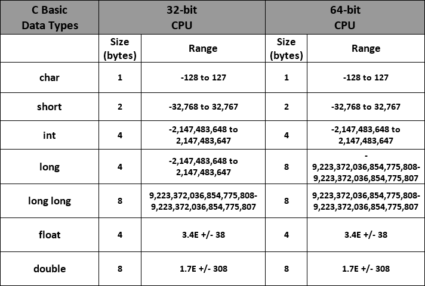

# Variable and Data Types

## Program Sederhana
```c
#include <stdio.h>

int main() {
    // Mencetak teks ke terminal
    printf("Hello, World\n");
    return 0;
}
```
### Memahami kode
Mari pahami kode tersebut baris per baris, dimulai dari baris yang pertama:

```c
#include <stdio.h>
```

Simbol `#` di dalam C menandakan bahwa baris tersebut adalah **preprocessor directive**, sebuah instruksi di dalam *source code* yang diproses oleh *preprocessor* sebelum proses kompilasi dimulai. Preprocessor directive biasanya memberikan instruksi ke compiler bagaimana harus menangani kode yang akan dikompilasi. Seperti pada baris di atas, kita memberikan perintah untuk menyertakan sebuah *library* bawaan C bernama `stdio.h` (*Standard Input/Output*) ke dalam *source code*. 

Tidak seperti baris kode C pada umumnya, preprocessor directive tidak memerlukan tanda titik koma (`;`) pada akhir barisnya.

```c
int main() {
    // ...
}
```

Selanjutnya, fungsi `main()` di atas adalah fungsi utama dalam sebuah kode C yang menjadi titik awal (*entry point*) yang akan dijalankan pertama kali oleh program.

```c
printf("Hello, World\n");
```

Fungsi `printf()` di atas adalah fungsi bawaan C yang terdapat pada library `stdio.h`. Fungsi ini digunakan untuk mencetak teks ke terminal berdasarkan argumen yang diberikan. Sebagai contoh, kita memberikan argumen berupa string `"Hello, World\n"`.

Perhatikan karakter `\n` di ujung teks tersebut:
- `\n` adalah sebuah **escape sequence** yang berarti **baris baru (*newline*)**.
- Fungsinya persis seperti menekan tombol **Enter** pada keyboard, sehingga teks yang dicetak berikutnya atau baris *prompt* di terminal akan berpindah ke baris baru di bawahnya dan tidak menempel.

```c
return 0;
```
Baris ini menyatakan nilai kembalian (*return value*) yang dikirimkan oleh fungsi `main` kepada sistem operasi ketika program telah selesai berjalan.

**Mengapa nilainya harus angka `0`?**  
Di dalam standar konvensi sistem operasi, angka `0` menandakan bahwa program **selesai dijalankan dengan sukses tanpa ada kendala (*exit status 0*)**. Sebaliknya, jika program mengembalikan angka selain 0 (misalnya `1` atau `-1`), sistem operasi akan menganggap bahwa program berhenti karena suatu kesalahan (*error*).

### Komentar (Comments)
Di dalam kode di atas, kalian juga melihat baris seperti ini:
```c
// Mencetak teks ke terminal
```
Baris tersebut dinamakan **Komentar (*Comment*)**.

Komentar adalah catatan atau penjelasan yang sengaja ditulis oleh programmer untuk dibaca oleh **manusia** (diri sendiri di masa depan atau rekan tim), bukan untuk komputer. Seluruh komentar akan **sepenuhnya diabaikan oleh compiler** dan tidak akan dieksekusi sama sekali saat program dijalankan.

Di bahasa C, terdapat 2 jenis komentar:

#### 1. Single-Line Comment (Komentar Satu Baris)
Diawali dengan tanda dua garis miring (`//`). Segala teks yang kalian tulis setelah tanda `//` hingga ujung baris tersebut akan dianggap sebagai komentar.
```c
// Ini adalah komentar satu baris
printf("Halo!\n"); // Komentar juga bisa diletakkan di samping baris kode
```

#### 2. Multi-Line Comment (Komentar Banyak Baris)
Diawali dengan tanda `/*` dan ditutup dengan tanda `*/`. Cocok digunakan jika kalian ingin menulis penjelasan yang panjang atau menonaktifkan beberapa baris kode sekaligus untuk keperluan pengujian (*debugging*).
```c
/*
  Ini adalah contoh komentar
  yang terdiri dari beberapa baris.
  Seluruh teks di dalam blok ini tidak akan dieksekusi.
*/
```

---

## Variable
Variable adalah **nama lokasi penyimpanan di memori komputer yang digunakan untuk menampung data atau nilai yang dapat diubah dan direferensikan kembali selama program berjalan.**

Biar gampang, bayangkan variabel sebagai sebuah **kotak kardus** yang diberi label nama. Kalian bisa menyimpan suatu barang (data) di dalam kotak tersebut, melihat isinya kapan saja, atau menukar isinya dengan barang baru selama jenis barangnya cocok dengan ukuran kotaknya!

Sintaks dasar pembuatan variabel:
```c
dataType variableName = value;
```

*   `dataType`: Tipe data dari variabel (seperti `int`, `float`, dll). Ini ibarat **ukuran dan bentuk kotak**.
*   `variableName`: Nama dari variabel tersebut. Ini ibarat **label nama** yang ditempel di kotak.
*   `value`: Nilai yang dimasukkan ke dalam kotak.

---

### Tahapan Menggunakan Variabel

Dalam bahasa C, terdapat beberapa cara berinteraksi dengan variabel yang perlu kalian pahami:

#### 1. Deklarasi Saja (*Declaration*)
Tahap memesan kotak di memori RAM dan memberinya label nama tanpa langsung memasukkan nilai (kotak masih kosong):
```c
int skor; // Komputer menyiapkan lokasi memori bernama 'skor' bertipe integer
```

#### 2. Penugasan (*Assignment*)
Tahap mengisi atau memperbarui nilai ke dalam variabel yang telah dideklarasikan sebelumnya menggunakan tanda sama dengan (`=`):
```c
int skor;   // 1. Deklarasi
skor = 100; // 2. Assignment (mengisi nilai ke variabel)
skor = 150; // 2. Assignment (memperbarui nilai tanpa menulis 'int' lagi)
```

#### 3. Deklarasi + Inisialisasi (*Declaration + Initialization*)
Cara praktis yang menggabungkan tahap deklarasi sekaligus pengisian nilai awal dalam satu baris instruksi:
```c
int skor = 100; // Loker 'skor' langsung dipesan dan diisi nilai awal 100
```

### Aturan Penamaan Variabel
Dalam bahasa C, kalian tidak bisa sembarangan memberi nama variabel. Ada aturan mutlak yang harus ditaati agar program kalian tidak *error* dan ditolak oleh compiler:

1.  **Awali dengan huruf atau *underscore* (`_`)**. 
    *   ✅ Benar: `umur`, `_saldo`, `nilaiTugas`
    *   ❌ Salah: `1angka`, `2024data` (tidak boleh diawali angka!)
2.  **Hanya boleh berisi huruf, angka, dan *underscore***. Jangan pernah menggunakan spasi atau simbol khusus seperti `@`, `#`, `!`, atau `-`.
    *   ✅ Benar: `nama_depan`, `angka123`
    *   ❌ Salah: `nama depan`, `email@`
3.  **Bersifat *Case Sensitive***. Huruf besar dan kecil dianggap berbeda. Variabel `Nilai` dan `nilai` adalah dua "kotak" yang benar-benar berbeda.
4.  **Dilarang pakai [*Reserved Words*](https://www.ibm.com/docs/en/wdfrhcw/1.4.0?topic=programs-c-reserved-keywords)**. Kalian tidak boleh menggunakan kata-kata yang sudah menjadi bawaan mutlak dari bahasa C (seperti `int`, `return`, `if`, `for`, `void`).

---

## Data Types
Kalau variabel adalah "kotaknya", maka tipe data adalah **jenis barang** apa yang boleh dimasukkan ke dalam kotak tersebut. C bersifat statically typed, ia perlu tahu tipe datanya sejak awal agar bisa menyiapkan ruang memori (*storage*) yang pas—tidak kurang dan tidak lebih.

Berikut adalah tipe data dasar (*primitive*) dan pengubahnya (*modifiers*) yang dapat kalian gunakan di bahasa C:

| Tipe Data | Deskripsi | Format Specifier | Contoh Penggunaan |
| :--- | :--- | :--- | :--- |
| **`char`** | Satu buah karakter (huruf, angka, simbol). Diapit kutip tunggal (`'`). | `%c` | `char nilai = 'A';` |
| **`unsigned char`** | Karakter positif / data biner 8-bit tanpa tanda minus ($0$ s.d. $255$). | `%c` atau `%u` | `unsigned char byte = 255;` |
| **`short`** *(short int)* | Bilangan bulat kecil (hemat memori). | `%hd` | `short tahun = 2026;` |
| **`unsigned short`** | Bilangan bulat positif berukuran kecil ($0$ s.d. $65.535$). | `%hu` | `unsigned short port = 8080;` |
| **`int`** | Bilangan bulat standar (integer) tanpa koma (paling sering digunakan). | `%d` atau `%i` | `int umur = 18;` |
| **`unsigned int`** | Bilangan bulat hanya positif (kapasitas angka positif 2x lipat lebih besar). | `%u` | `unsigned int pengunjung = 50000;` |
| **`long`** *(long int)* | Bilangan bulat berkapasitas besar untuk angka bernilai tinggi. | `%ld` | `long jarak = 1500000L;` |
| **`unsigned long`** | Bilangan bulat besar yang hanya bernilai positif. | `%lu` | `unsigned long id = 4000000000UL;` |
| **`long long`** | Bilangan bulat ekstra besar untuk angka miliaran/triliunan (64-bit). | `%lld` | `long long populasi = 8000000000LL;` |
| **`unsigned long long`** | Bilangan bulat ekstra besar yang hanya bernilai positif. | `%llu` | `unsigned long long saldo = 1000000000000ULL;` |
| **`float`** | Bilangan desimal/pecahan dengan tingkat presisi standar ($\approx 6$–$7$ digit). | `%f` | `float ipk = 3.95;` |
| **`double`** | Bilangan desimal presisi ganda (lebih akurat daripada float, $\approx 15$–$17$ digit). | `%lf` | `double pi = 3.1415926535;` |
| **`long double`** | Bilangan desimal presisi ultra-tinggi untuk kalkulasi saintifik. | `%Lf` | `long double konstanta = 1.23456789L;` |
| **`bool`** *(C99)* | Nilai logika kebenaran (`true` atau `false`), butuh `#include <stdbool.h>`. | `%d` | `bool isLulus = true;` |

### Ukuran Memori dan Rentang Nilai (Size & Value Range)
Setiap tipe data memiliki batas kapasitasnya masing-masing. Secara umum, pada arsitektur CPU dan OS modern, ukuran untuk tipe data dasar telah distandarisasi seperti tabel berikut:




:::tip

Karena bahasa C sangat bergantung dengan sistem yang kalian gunakan , kalian bisa langsung melihat ukuran memori variabel di device kalian masing-masing menggunakan fungsi bawaan `sizeof()`.

Contoh: `printf("Ukuran int: %zu bytes\n", sizeof(int));`

:::


---

## Basic I/O
Program yang diam saja tentu membosankan, bukan? Input dan output adalah cara agar program yang kita buat bisa berinteraksi dengan dunia luar, baik dengan file, program lain, atau pengguna. Untuk materi kali ini, kita hanya akan fokus membahas interaksi langsung dengan pengguna.

### Basic Output (Mencetak Data)
Salah satu contoh output yang paling sederhana adalah mencetak tulisan ke *console* (terminal). Seperti yang telah kita bahas di awal, kita menggunakan fungsi `printf()` untuk mencetak apa pun yang kita berikan ke layar.

```c
printf("Hello world!\n");
printf("%d\n", 1234); // Format untuk mencetak angka langsung
```

Sejauh ini, kita baru mempelajari cara mencetak tulisan mentah atau data langsung. Lalu, bagaimana jika kita ingin mencetak **nilai yang tersimpan di dalam sebuah variabel**? Kita bisa menggunakan *Format Specifier* (konstanta format) sebagai "tempat singgah" (*placeholder*).


**Contoh Kode:**
```c
#include <stdio.h>

int main() {
    char nama[16] = "Budi"; // Ini adalah contoh deklarasi String
    int umur = 19;
    float nilai = 3.89;

    printf("Nama %s, umur %d tahun, dan nilai %f\n", nama, umur, nilai);
    return 0;
}
```

**Output di terminal:**
```text
Nama Budi, umur 19 tahun, dan nilai 3.890000
```

Seperti yang dapat kita lihat, konstanta format `%s`, `%d`, dan `%f` diletakkan di dalam teks, lalu nilai aslinya disuplai secara berurutan di sebelah kanan string melalui variabel `nama`, `umur`, dan `nilai`.

#### Mengatur Presisi Angka Desimal (*Precision Formatting*)
Kalian mungkin memperhatikan pada *output* di atas: mengapa nilai `3.89` dicetak menjadi **`3.890000`** dengan empat angka nol tambahan di belakangnya?

Secara *default* di bahasa C, format specifier `%f` akan **selalu mencetak 6 digit angka di belakang koma**.

Untuk mengatur seberapa banyak digit desimal yang ingin kita tampilkan, kita cukup menyisipkan tanda titik dan jumlah digit (**.N**) di antara simbol `%` dan `f`:

| Format | Keterangan | Nilai Variabel: `3.8916` | Output yang Tampil |
| :---: | :--- | :---: | :---: |
| **`%f`** | Standar *default* (selalu 6 digit) | `3.8916` | `3.891600` |
| **`%.2f`** | Membatasi tepat **2 digit** desimal | `3.8916` | `3.89` |
| **`%.1f`** | Membatasi tepat **1 digit** desimal | `3.8916` | `3.9` |
| **`%.0f`** | **Tanpa digit desimal** (dibulatkan) | `3.8916` | `4` |  
### Basic Input (Menerima Data)
Selanjutnya, kita akan mempelajari bagaimana cara meminta pengguna untuk mengisi sebuah variabel yang terdapat di program kita. Perhatikan contoh kode berikut:

```c
#include <stdio.h>

int main() {
    char nama[32];
    int umur;

    printf("Masukkan nama: ");
    scanf("%s", nama);

    printf("Masukkan umur: ");
    scanf("%d", &umur);

    printf("Nama saya %s dan umur saya %d tahun\n", nama, umur);
    return 0;
}
```

Dari program tersebut, terdapat kata kunci baru, yaitu **`scanf()`**. Kata kunci tersebut merupakan sebuah fungsi untuk menangkap masukan/input pengguna dari *console* menggunakan format atau *placeholder* yang sama persis dengan yang dipakai di fungsi `printf()`.

*   `scanf("%s", nama);` -> Menangkap input teks dan memindahkannya ke variabel `nama`.
*   `scanf("%d", &umur);` -> Menangkap input angka bulat dan memindahkannya ke variabel `umur`.

Mengapa Butuh Ampersand (`&`)?
Kalian pasti menyadari ada simbol ampersand (`&`) di depan variabel tipe data *integer* (`&umur`). Simbol `&` berfungsi sebagai penunjuk "Alamat Memori". Fungsi `scanf()` itu seperti kurir paket; ia tidak hanya butuh tahu "apa isi barangnya", tapi butuh **"alamat rumah pasti"** agar barang (input) tersebut bisa diletakkan tepat ke dalam memori komputer kalian.

*Lalu kenapa variabel string (`nama`) tidak butuh `&`?* Karena variabel jenis *array* (seperti `char nama[32]`) pada dasarnya memang sudah menyimpan referensi alamat memori secara default.

:::warning[Kelemahan `scanf()` pada Teks]
Fungsi `scanf()` yang kita gunakan ini memiliki sedikit kelemahan: ia tidak bisa menerima string (kalimat) yang menggunakan spasi. Saat kalian mengetik "Budi Santoso", `scanf("%s")` akan berhenti membaca saat bertemu spasi pertama, sehingga yang tersimpan hanya "Budi". Namun tenang saja, kita akan tetap menggunakan metode ini untuk sekarang, dan akan belajar cara mengatasinya nanti!
:::
