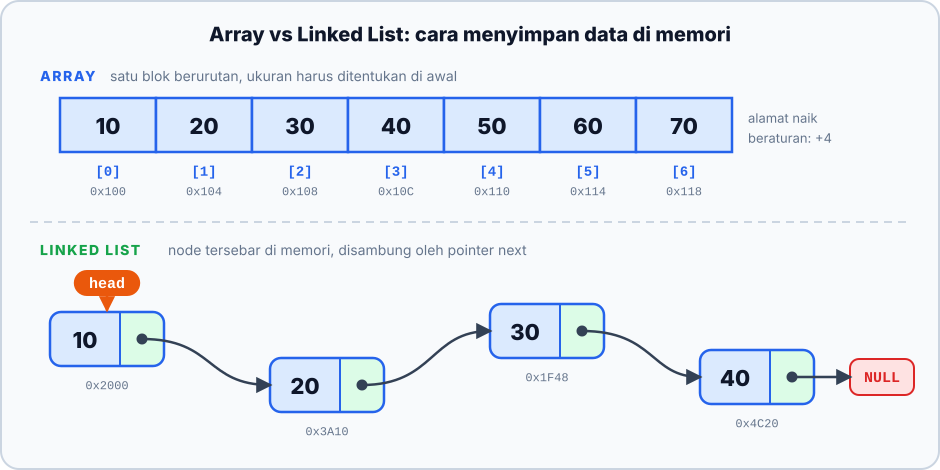
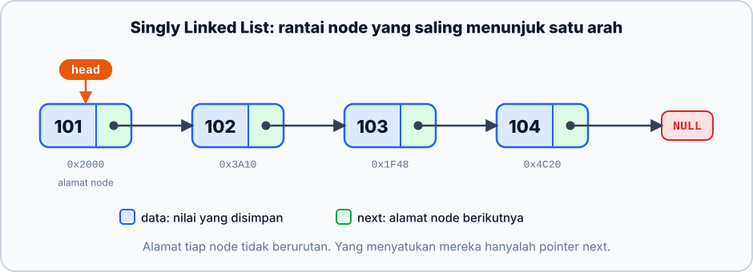
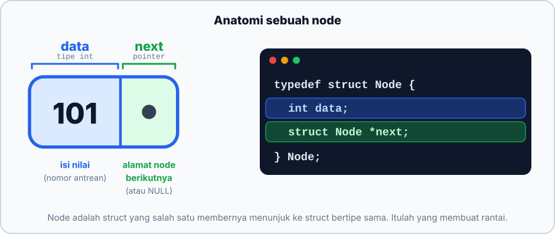
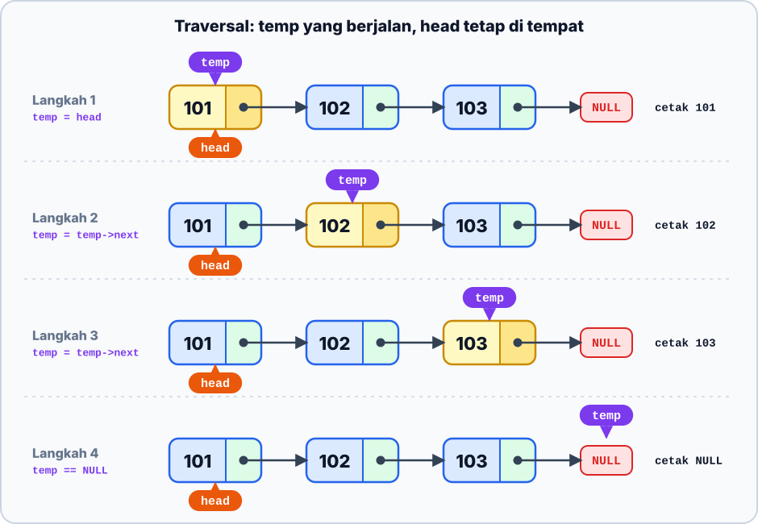
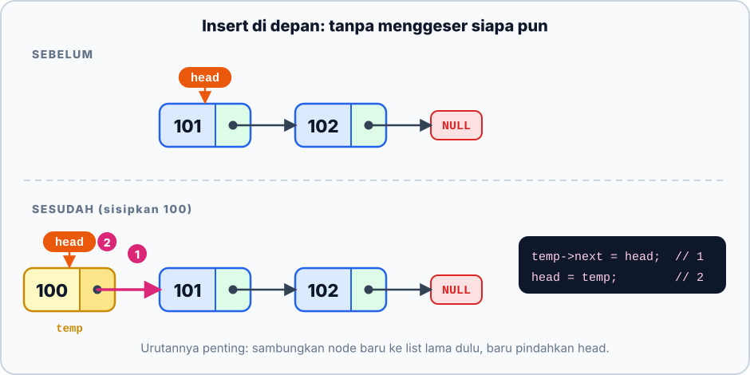
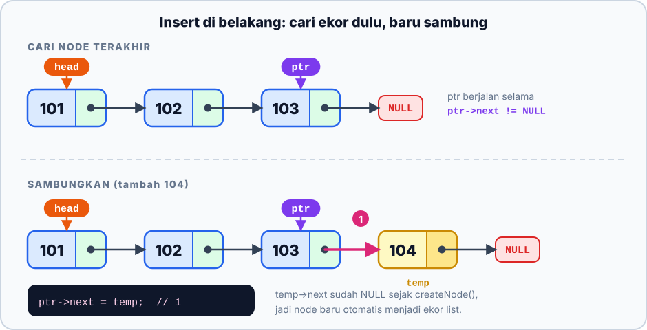
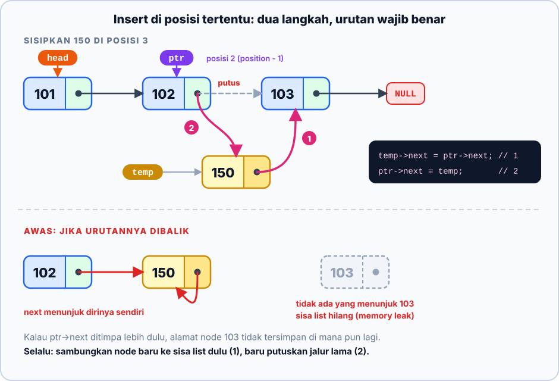
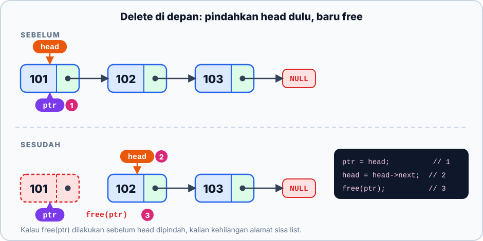
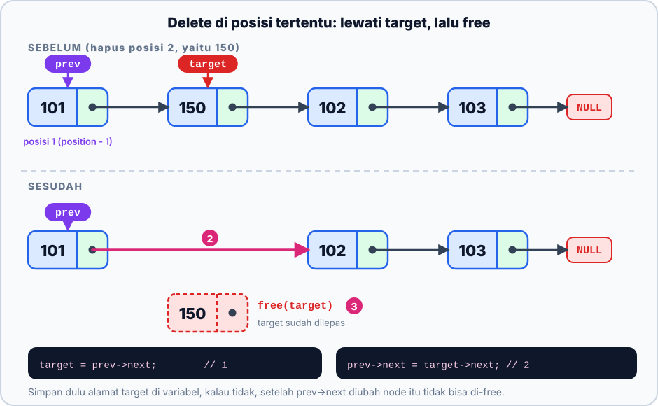

import CodeBlock from "@theme/CodeBlock";
import Kode01 from "!!raw-loader!@site/docs/Materi/pertemuan 10/kode/01_node_dasar.c";
import Kode02 from "!!raw-loader!@site/docs/Materi/pertemuan 10/kode/02_traversal.c";
import Kode03 from "!!raw-loader!@site/docs/Materi/pertemuan 10/kode/03_insert.c";
import Kode04 from "!!raw-loader!@site/docs/Materi/pertemuan 10/kode/04_delete.c";
import Kode05 from "!!raw-loader!@site/docs/Materi/pertemuan 10/kode/05_search_update.c";
import Kode06 from "!!raw-loader!@site/docs/Materi/pertemuan 10/kode/06_studi_kasus_antrean.c";

Pada materi-materi sebelumnya, kita sudah belajar array, pointer, struct, dan
sedikit dynamic memory allocation. Sekarang semuanya akan bertemu dalam satu
struktur data baru yaitu **linked list**.

Mari mulai dari masalah yang sering muncul pada array. Misalkan kalian membuat
program antrean loket dengan `int antrean[100]`:

- Jika yang datang ternyata 101 orang, array sudah penuh dan ukurannya **tidak bisa ditambah**.
- Jika yang datang hanya 5 orang, 95 tempat lainnya terbuang percuma.
- Jika seseorang menyela di urutan ke-2, semua orang di belakangnya harus **digeser satu per satu**.

Linked list lahir untuk menyelesaikan ketiga masalah itu. Datanya tidak
disimpan dalam satu blok yang kaku, tetapi dalam potongan-potongan kecil yang
**saling menunjuk**, dan potongan baru bisa ditambahkan kapan saja.



_Array menyimpan data berdempetan dalam satu blok. Linked list menyimpan data di
node yang tersebar, lalu menyambungkannya dengan pointer._

---

## Tujuan Praktikum

Setelah menyelesaikan praktikum ini, kalian diharapkan mampu:

- Menjelaskan apa itu linked list, node, `head`, dan `NULL`, serta kapan linked list lebih cocok daripada array.
- Mendefinisikan node dengan `struct` yang menunjuk dirinya sendiri dan membuatnya dengan `malloc()`.
- Melakukan traversal untuk mencetak, menghitung, dan membersihkan list.
- Menyisipkan node di depan, di belakang, dan di posisi tertentu.
- Menghapus node dari depan, belakang, dan posisi tertentu tanpa membuat list putus atau _memory leak_.
- Mencari dan mengubah data dalam list.
- Menyelesaikan permasalahan sederhana menggunakan singly linked list.

:::info

Linked list punya beberapa jenis: _singly_, _doubly_, dan _circular_. Pada
pertemuan ini kita **hanya fokus pada singly linked list**, yaitu list yang
setiap node-nya hanya tahu siapa yang ada **di belakangnya**.

:::

---

### Kuis Pemanasan

**1.** Benar atau salah: memori yang dipesan dengan `malloc()` tetap ada sampai kita memanggil `free()`.

<details>
<summary>Lihat jawaban</summary>

**Benar.** `malloc()` memesan memori di _heap_. Memori itu tidak hilang saat
function selesai, jadi harus dikembalikan sendiri dengan `free()`.

</details>

**2.** Jika `p` adalah pointer ke struct yang punya member `data`, bagaimana cara mengakses `data` lewat `p`?

<details>
<summary>Lihat jawaban</summary>

`p->data` (sama dengan `(*p).data`).

</details>

**3.** Nilai apa yang dipakai pointer untuk menandakan "tidak menunjuk ke mana pun"?

<details>
<summary>Lihat jawaban</summary>

`NULL`.

</details>

**4.** Setelah program berjalan, bisakah `int nilai[5]` tiba-tiba menjadi 6 elemen?

<details>
<summary>Lihat jawaban</summary>

**Tidak.** Ukuran array tetap sejak dideklarasikan. Inilah salah satu
keterbatasan yang ingin diatasi linked list.

</details>

---

## Konsep Dasar: Rantai Petunjuk

Bayangkan permainan **mencari harta karun**. Kalian hanya diberi _petunjuk
pertama_. Di dalam petunjuk itu tertulis lokasi petunjuk kedua, di petunjuk
kedua tertulis lokasi petunjuk ketiga, dan seterusnya sampai petunjuk terakhir
yang bertuliskan "selesai".

```text
┌────────────┐     ┌────────────┐     ┌────────────┐
│ Petunjuk 1 │     │ Petunjuk 2 │     │ Petunjuk 3 │
│ isi: 101   │     │ isi: 102   │     │ isi: 103   │
│ lanjut ke ─┼────►│ lanjut ke ─┼────►│ lanjut ke ─┼──► SELESAI
└────────────┘     └────────────┘     └────────────┘
```

Itulah linked list. Ada dua hal penting dari analogi ini:

- Kalian **harus mulai dari petunjuk pertama**. Tidak bisa langsung melompat ke petunjuk ke-5, karena lokasinya hanya diketahui dari petunjuk ke-4.
- Petunjuk boleh disembunyikan **di mana saja**. Letaknya tidak perlu berdekatan, yang penting setiap petunjuk memuat lokasi petunjuk berikutnya.

### Istilah yang Perlu Dihafal

| Istilah  | Artinya                                                                        |
| -------- | ------------------------------------------------------------------------------ |
| **Node** | Satu "kotak" dalam rantai. Berisi data dan pointer.                            |
| `data`   | Bagian node yang menyimpan nilai (di materi ini berupa `int`).                 |
| `next`   | Pointer di dalam node yang menyimpan **alamat node berikutnya**.               |
| `head`   | Pointer yang menyimpan alamat **node pertama**. Pintu masuk ke seluruh list.   |
| `NULL`   | Nilai `next` pada node terakhir. Penanda bahwa rantai sudah berakhir.          |



:::info

Perhatikan bahwa `head` **bukan node**. `head` hanya pointer yang menunjuk ke
node pertama. Jika list kosong, `head` bernilai `NULL`.

:::

### Mengapa Tidak Pakai Array Saja?

Tidak ada struktur data yang selalu terbaik. Masing-masing punya kelebihan dan
kekurangan:

| Hal yang dibandingkan        | Array                         | Singly Linked List                      |
| ---------------------------- | ----------------------------- | --------------------------------------- |
| Letak di memori              | Satu blok berurutan           | Node tersebar, disambung pointer        |
| Ukuran                       | Tetap                         | Fleksibel, bertambah saat dibutuhkan    |
| Akses elemen ke-`i`          | Langsung (`a[i]`)             | Harus berjalan dari `head`              |
| Sisip atau hapus di depan    | Geser semua elemen            | Cukup ubah beberapa pointer             |
| Memori tambahan per elemen   | Tidak ada                     | Satu pointer `next` per node            |

Jadi linked list unggul saat data **sering ditambah dan dihapus**, terutama di
depan. Array unggul saat kita **sering mengakses data berdasarkan indeks**.

---

## Alur Belajar: Case "Loket Antrean Kampus"

Seluruh materi ini mengikuti **satu cerita**. Kalian diminta membuat program
untuk loket layanan di kampus. Setiap orang yang datang mengambil nomor, dan
nomor itu disimpan sebagai satu node. Di setiap tahap akan muncul masalah baru,
dan linked list menjadi jawabannya.

| Tahap | Masalah yang kalian hadapi                                  | Konsep yang dipelajari                    |
| ----- | ----------------------------------------------------------- | ----------------------------------------- |
| 1     | Bagaimana satu nomor antrean tahu siapa yang ada di belakangnya? | `struct Node`, `malloc`, `head`, `NULL` |
| 2     | Petugas ingin membaca seluruh antrean                       | Traversal, pointer `temp`, `free` seluruh list |
| 3     | Ada yang datang: di belakang, lewat jalur prioritas, atau menyela | Insert depan, belakang, posisi tertentu |
| 4     | Ada yang dilayani atau membatalkan nomornya                 | Delete depan, belakang, posisi tertentu   |
| 5     | Petugas mencari satu nomor dan memperbaiki nomor yang salah | Searching dan updating                    |
| 6     | Menggabungkan semuanya menjadi program antrean utuh         | Studi kasus menu interaktif               |

:::tip

Setiap tahap memiliki program lengkap yang bisa kalian salin dan jalankan. Cara
compile-nya:

```bash
gcc nama_file.c -o nama_file
./nama_file
```

Jangan hanya dibaca. Ketik ulang, ubah-ubah kodenya, dan **gambar dulu di
kertas** sebelum menebak hasilnya. Hampir semua kesalahan pada linked list
terjadi karena kita salah membayangkan arah panah pointer.

:::

---

## Tahap 1: Mengenal Node

Seorang pengunjung datang dan mengambil **nomor antrean 101**. Selanjutnya
datang 102, lalu 103. Agar petugas bisa menelusuri urutannya, setiap nomor harus
tahu **siapa nomor di belakangnya**. Satu nomor beserta penunjuk ke nomor
berikutnya inilah yang kita sebut **node**.



### Mendefinisikan Node

```c
typedef struct Node {
    int data;           // nomor antrean
    struct Node *next;  // alamat node berikutnya
} Node;
```

Ada satu hal yang unik: struct ini punya member berupa **pointer ke tipe
dirinya sendiri**. Karena itulah node bisa membentuk rantai.

:::warning

Di dalam definisi, kita harus menulis `struct Node *next`, bukan `Node *next`.
Alasannya, nama alias `Node` baru "resmi" terdaftar setelah kurung kurawal
penutup dan `typedef` selesai dibaca compiler. Di dalam struct, yang sudah
dikenal baru nama tag-nya, yaitu `struct Node`.

:::

### Membuat Node Baru dengan `malloc()`

Mengapa node dibuat dengan `malloc()`, bukan dengan variabel biasa seperti
`Node n;`?

Variabel biasa yang dibuat di dalam function akan **hilang begitu function
selesai**. Kita butuh node yang tetap hidup setelah function `createNode()`
berakhir, dan itu hanya bisa didapat dari memori **heap** lewat `malloc()`.

```c
Node *createNode(int data) {
    Node *newNode = (Node *)malloc(sizeof(Node));
    if (newNode == NULL) {
        printf("Alokasi memori gagal!\n");
        exit(1);
    }
    newNode->data = data;
    newNode->next = NULL;   // node baru belum menunjuk siapa pun
    return newNode;
}
```

Perhatikan tiga hal:

- `sizeof(Node)` dipakai agar ukuran memori selalu tepat, berapa pun isi struct-nya.
- Hasil `malloc()` **selalu dicek**. Jika memori habis, hasilnya `NULL`.
- `newNode->next = NULL` itu penting. Tanpa baris ini, `next` berisi _garbage value_ dan bisa menunjuk ke alamat sembarangan.

### Menyambung Node Menjadi Rantai

Setelah tiga node dibuat, mereka masih berdiri sendiri-sendiri. Kita
sambungkan dengan mengisi pointer `next`:

```c
Node *head = createNode(101);
Node *kedua = createNode(102);
Node *ketiga = createNode(103);

head->next = kedua;     // 101 menunjuk 102
kedua->next = ketiga;   // 102 menunjuk 103
```

Sekarang `head` menunjuk 101, 101 menunjuk 102, 102 menunjuk 103, dan 103
menunjuk `NULL` (nilai bawaan dari `createNode`). Untuk mengakses data, kita
melompat satu panah demi satu panah:

```text
head->data              → 101
head->next->data        → 102
head->next->next->data  → 103
```

### Program Lengkap Tahap 1

<CodeBlock language="c" title="01_node_dasar.c" showLineNumbers>
    {Kode01}
</CodeBlock>

<a
    href={`data:text/plain;charset=utf-8,${encodeURIComponent(Kode01)}`}
    download="01_node_dasar.c"
>
    ⬇ Unduh 01_node_dasar.c
</a>

**Output di terminal:**

```text
Node pertama : 101
Node kedua   : 102
Node ketiga  : 103

Node ketiga adalah node terakhir (next == NULL)
```

Mengakses node satu per satu seperti ini cukup melelahkan. Bagaimana jika
listnya berisi 1000 node? Tahap 2 menjawabnya dengan _loop_.

### Kuis 1

**1.** Sebuah node terdiri dari dua bagian. Apa saja?

<details>
<summary>Lihat jawaban</summary>

**Data** (nilai yang disimpan) dan **next** (pointer ke node berikutnya).

</details>

**2.** Pada list `101 -> 102 -> 103 -> NULL`, berapa nilai `head->next->data`?

<details>
<summary>Lihat jawaban</summary>

**102.** `head` menunjuk 101, lalu `->next` melompat ke 102.

</details>

**3.** Berapa nilai `next` milik node terakhir?

<details>
<summary>Lihat jawaban</summary>

`NULL`.

</details>

**4.** Benar atau salah: node-node dalam linked list harus berdekatan di memori.

<details>
<summary>Lihat jawaban</summary>

**Salah.** Node boleh tersebar di mana saja. Yang menyatukan mereka adalah
pointer `next`.

</details>

**5.** Mengapa `createNode()` memakai `malloc()` dan bukan variabel biasa?

<details>
<summary>Lihat jawaban</summary>

Variabel biasa di dalam function hilang saat function selesai. Memori dari
`malloc()` berada di heap dan tetap ada sampai di-`free()`.

</details>

---

## Tahap 2: Traversal

Petugas loket ingin melihat **seluruh antrean**, dari nomor pertama sampai
terakhir. Aktivitas "mengunjungi setiap node satu per satu" ini disebut
**traversal**.

### Pointer `temp`: Kunci dari Hampir Semua Operasi

Kita butuh sebuah pointer pembantu yang **berjalan** dari node ke node. Pointer
itu biasa dinamai `temp` atau `ptr`.



```c
void printList(const Node *head) {
    const Node *temp = head;       // temp mulai dari node pertama
    while (temp != NULL) {         // selama belum melewati node terakhir
        printf("%d -> ", temp->data);
        temp = temp->next;         // melangkah ke node berikutnya
    }
    printf("NULL\n");
}
```

:::info

**Mengapa tidak langsung memakai `head`?**

Karena `head` adalah **satu-satunya pegangan** kita ke seluruh list. Jika `head`
digeser sampai `NULL`, alamat node pertama hilang dan node-node itu tidak bisa
lagi dicapai maupun di-`free()`. Itu **memory leak**. Maka kita pinjam `head`
ke `temp`, dan `temp` yang berjalan.

:::

Perhatikan kondisi loopnya: `temp != NULL`. Jika kalian menulis
`temp->next != NULL`, loop berhenti **sebelum** node terakhir diproses, dan
program _crash_ pada list kosong karena `NULL->next` tidak valid.

### Menghitung Node dan Membersihkan List

Pola traversal yang sama bisa dipakai untuk banyak hal:

```c
int countNodes(const Node *head) {
    int count = 0;
    const Node *temp = head;
    while (temp != NULL) {
        count++;
        temp = temp->next;
    }
    return count;
}
```

Untuk mengembalikan seluruh memori, kita juga traversal, tetapi dengan satu
trik penting:

```c
void freeList(Node *head) {
    Node *temp;
    while (head != NULL) {
        temp = head;        // simpan node yang akan dibuang
        head = head->next;  // geser head dulu
        free(temp);         // baru buang node lama
    }
}
```

Mengapa `head` digeser **sebelum** `free()`? Karena setelah node di-`free()`,
kita tidak boleh lagi membaca isinya, termasuk `next`. Alamat node berikutnya
harus diamankan dulu.

### Konsekuensinya

Traversal harus mengunjungi node satu per satu, jadi makin panjang list, makin
banyak langkah yang dibutuhkan. Inilah alasan linked list tidak bisa melakukan
`a[i]` secepat array: untuk sampai ke node ke-`i`, kita harus melangkah `i` kali
dari `head`.

### Program Lengkap Tahap 2

<CodeBlock language="c" title="02_traversal.c" showLineNumbers>
    {Kode02}
</CodeBlock>

<a
    href={`data:text/plain;charset=utf-8,${encodeURIComponent(Kode02)}`}
    download="02_traversal.c"
>
    ⬇ Unduh 02_traversal.c
</a>

**Output di terminal:**

```text
List kosong  : NULL
Jumlah node  : 0

Isi antrean  : 101 -> 102 -> 103 -> 104 -> NULL
Jumlah node  : 4
```

Perhatikan bahwa list kosong (`head == NULL`) tetap aman diproses. Loop tidak
berjalan sama sekali, dan `printList` langsung mencetak `NULL`.

### Kuis 2

**1.** Apa kondisi `while` yang benar untuk menelusuri seluruh node?

<details>
<summary>Lihat jawaban</summary>

`while (temp != NULL)`.

</details>

**2.** Jika list kosong, berapa nilai `head`, dan apa yang dicetak `printList`?

<details>
<summary>Lihat jawaban</summary>

`head` bernilai `NULL`, dan `printList` hanya mencetak `NULL`.

</details>

**3.** Berapa hasil `countNodes` untuk list `5 -> 6 -> 7 -> NULL`?

<details>
<summary>Lihat jawaban</summary>

**3.**

</details>

**4.** Mengapa traversal memakai `temp`, bukan menggeser `head` langsung?

<details>
<summary>Lihat jawaban</summary>

Karena `head` satu-satunya pegangan ke awal list. Jika `head` ikut bergeser,
node di depannya tidak bisa dicapai lagi dan memorinya bocor.

</details>

**5.** Mengapa linked list tidak bisa langsung membaca node ke-100 seperti `a[99]` pada array?

<details>
<summary>Lihat jawaban</summary>

Karena list hanya menyimpan alamat node pertama (`head`). Untuk sampai ke node
ke-100, kita harus melewati 99 panah `next` satu per satu.

</details>

---

## Tahap 3: Insertion (Menambah Node)

Ada tiga cara orang bergabung ke antrean loket:

1. **Di belakang**: pengunjung biasa yang baru datang.
2. **Di depan**: pengunjung prioritas, misalnya lansia.
3. **Di posisi tertentu**: seseorang menyela di tengah.

### 3A. Insert di Depan

Node baru menunjuk ke node pertama yang lama, lalu `head` dipindahkan ke node
baru. Tidak ada node lain yang perlu digeser.



```c
Node *insertBeginning(Node *head, int data) {
    Node *temp = createNode(data);
    temp->next = head;   // 1. sambungkan ke list lama
    return temp;         // 2. node baru menjadi head
}
```

Karena `head` berubah, function ini **mengembalikan head yang baru**. Cara
memakainya:

```c
head = insertBeginning(head, 100);
```

Jika list masih kosong, `head` bernilai `NULL`, sehingga node baru menunjuk
`NULL` dan menjadi satu-satunya node. Tidak perlu penanganan khusus.

:::info

**Cepat, berapa pun panjang list**

Jumlah langkahnya selalu sama (dua pointer diubah). Pada array, insert di depan
harus menggeser **seluruh** elemen.

:::

### 3B. Insert di Belakang

Kita harus mencari node terakhir terlebih dahulu, yaitu node yang `next`-nya
`NULL`, lalu menyambungkannya ke node baru.



```c
Node *insertEnd(Node *head, int data) {
    Node *temp = createNode(data);

    if (head == NULL) {      // list kosong: node baru langsung jadi head
        return temp;
    }

    Node *ptr = head;
    while (ptr->next != NULL) {   // berhenti di node terakhir
        ptr = ptr->next;
    }
    ptr->next = temp;
    return head;
}
```

Di sini kondisi loopnya justru `ptr->next != NULL`, bukan `ptr != NULL`.
Tujuannya berhenti **di** node terakhir, bukan **setelah** node terakhir. Kita
butuh node terakhir itu untuk diubah `next`-nya.

:::info

**Lebih lambat daripada insert di depan**

Kita harus berjalan melewati seluruh list untuk mencapai ujungnya, jadi makin
panjang list, makin banyak langkahnya. Ada trik untuk menghilangkan perjalanan
itu dengan menyimpan pointer `tail`, dibahas di bagian Bonus.

:::

### 3C. Insert di Posisi Tertentu

Posisi dihitung mulai dari 1. Untuk menyisipkan node di posisi `position`, kita
berhenti di node **sebelum** posisi itu (posisi `position - 1`), lalu
menyisipkan node baru setelahnya.



```c
Node *insertAtPosition(Node *head, int data, int position) {
    if (position < 1) {
        printf("Posisi %d tidak valid!\n", position);
        return head;
    }
    if (position == 1) {
        return insertBeginning(head, data);
    }

    // Berhenti di node ke-(position - 1)
    Node *ptr = head;
    for (int pos = 1; pos < position - 1 && ptr != NULL; pos++) {
        ptr = ptr->next;
    }
    if (ptr == NULL) {
        printf("Posisi %d melebihi panjang list!\n", position);
        return head;
    }

    Node *temp = createNode(data);
    temp->next = ptr->next;   // 1. sambungkan dulu ke sisa list
    ptr->next = temp;         // 2. baru putuskan jalur lama
    return head;
}
```

:::warning

**Urutan dua baris terakhir tidak boleh tertukar**

Jika `ptr->next = temp` dikerjakan lebih dulu, alamat node setelahnya tidak
tersimpan di mana pun lagi. Sisa list **hilang** dan `temp->next` malah
menunjuk dirinya sendiri. Aturannya: **sambungkan node baru ke sisa list dulu,
baru putuskan jalur yang lama.**

:::

Pengecekan di awal juga penting. Posisi 1 sebenarnya sama dengan insert di
depan, dan posisi di luar panjang list harus ditolak, bukan dibiarkan membuat
program _crash_.

### Program Lengkap Tahap 3

<CodeBlock language="c" title="03_insert.c" showLineNumbers>
    {Kode03}
</CodeBlock>

<a
    href={`data:text/plain;charset=utf-8,${encodeURIComponent(Kode03)}`}
    download="03_insert.c"
>
    ⬇ Unduh 03_insert.c
</a>

**Output di terminal:**

```text
Insert di belakang  : 101 -> 102 -> 103 -> NULL
Insert di depan     : 100 -> 101 -> 102 -> 103 -> NULL
Insert di posisi 3  : 100 -> 101 -> 150 -> 102 -> 103 -> NULL

Posisi 0 tidak valid!
Posisi 10 melebihi panjang list!
```

### Kuis 3

**1.** Insert di mana yang paling cepat pada singly linked list (tanpa `tail`)?

<details>
<summary>Lihat jawaban</summary>

**Di depan**, karena tidak perlu traversal.

</details>

**2.** Jika list `101 -> 102 -> 103 -> NULL`, apa hasil `head = insertBeginning(head, 100);`?

<details>
<summary>Lihat jawaban</summary>

`100 -> 101 -> 102 -> 103 -> NULL`

</details>

**3.** Mengapa function `insertBeginning` mengembalikan `Node *`?

<details>
<summary>Lihat jawaban</summary>

Karena `head` berubah menjadi node baru, dan pemanggil perlu tahu `head` yang
terbaru.

</details>

**4.** Pada insert di posisi tertentu, mana urutan yang benar?

- (a) `ptr->next = temp;` lalu `temp->next = ptr->next;`
- (b) `temp->next = ptr->next;` lalu `ptr->next = temp;`

<details>
<summary>Lihat jawaban</summary>

**(b).** Sambungkan node baru ke sisa list dulu, baru ubah `ptr->next`. Pada (a),
alamat sisa list sudah tertimpa.

</details>

**5.** Mengapa insert di belakang lebih lambat daripada insert di depan?

<details>
<summary>Lihat jawaban</summary>

Kita harus berjalan dari `head` sampai node terakhir, karena list hanya
menyimpan alamat node pertama.

</details>

**6.** Apa yang dilakukan `insertAtPosition` jika `position` bernilai 1?

<details>
<summary>Lihat jawaban</summary>

Memanggil `insertBeginning`, karena menyisip di posisi 1 sama dengan menyisip di
depan.

</details>

---

## Tahap 4: Deletion (Menghapus Node)

Sekarang giliran sebaliknya. Nomor terdepan dipanggil ke loket (dihapus dari
depan), nomor terakhir pulang karena bosan menunggu (dihapus dari belakang), dan
ada yang membatalkan nomornya di tengah antrean.

Saat menghapus node, ada **dua tugas** yang harus selesai:

1. **Menyambung ulang** pointer supaya list tidak putus.
2. **`free()`** node yang dibuang supaya memorinya kembali ke sistem.

Jika tugas kedua dilupakan, node itu tidak lagi terjangkau tetapi tetap memakan
memori. Itulah **memory leak**.

### 4A. Delete di Depan

Pindahkan `head` ke node kedua, lalu buang node pertama.



```c
Node *deleteFirst(Node *head) {
    if (head == NULL) {
        printf("List kosong!\n");
        return NULL;
    }
    Node *ptr = head;     // 1. catat node yang akan dibuang
    head = head->next;    // 2. pindahkan head dulu
    free(ptr);            // 3. baru buang node lama
    return head;
}
```

Urutannya wajib begitu. Jika `free(ptr)` dilakukan lebih dulu, alamat node kedua
(yang tersimpan di dalam node pertama) ikut hilang.

### 4B. Delete di Belakang

Pada singly linked list, node terakhir **tidak tahu siapa yang ada di
depannya**. Padahal kita perlu mengubah `next` node sebelum terakhir menjadi
`NULL`. Maka kita jalankan **dua pointer**: `curr` di node terakhir, dan `prev`
satu langkah di belakangnya.

```c
Node *deleteLast(Node *head) {
    if (head == NULL) {
        printf("List kosong!\n");
        return NULL;
    }
    if (head->next == NULL) {   // hanya satu node
        free(head);
        return NULL;
    }

    Node *prev = head;
    Node *curr = head->next;
    while (curr->next != NULL) {
        prev = curr;
        curr = curr->next;
    }
    prev->next = NULL;   // prev menjadi node terakhir
    free(curr);
    return head;
}
```

Kasus **satu node** harus ditangani terpisah. Jika tidak, setelah node itu
di-`free()`, `head` masih menyimpan alamat yang sudah tidak valid
(_dangling pointer_). Karena itu function mengembalikan `NULL` agar `head`
ikut dikosongkan.

:::info

**Harus berjalan sampai ujung**

Kita harus berjalan sampai ujung untuk menemukan node sebelum terakhir. Pada
_doubly_ linked list hal ini bisa lebih mudah, tetapi itu bukan topik hari ini.

:::

### 4C. Delete di Posisi Tertentu

Idenya mirip insert: berhenti di node **sebelum** target (`prev`), lalu
"lewati" target dengan menyambungkan `prev` langsung ke node setelahnya.



```c
Node *deleteAtPosition(Node *head, int position) {
    if (head == NULL) {
        printf("List kosong!\n");
        return NULL;
    }
    if (position < 1) {
        printf("Posisi %d tidak valid!\n", position);
        return head;
    }
    if (position == 1) {
        return deleteFirst(head);
    }

    // Berhenti di node ke-(position - 1)
    Node *prev = head;
    for (int pos = 1; pos < position - 1 && prev->next != NULL; pos++) {
        prev = prev->next;
    }

    Node *target = prev->next;
    if (target == NULL) {
        printf("Posisi %d tidak ada di list!\n", position);
        return head;
    }

    prev->next = target->next;   // lewati target
    free(target);
    return head;
}
```

Variabel `target` menyimpan alamat node yang akan dibuang **sebelum**
`prev->next` diubah. Tanpa variabel ini, setelah `prev->next` ditimpa kita tidak
punya cara lagi untuk menemukan node itu dan men-`free()`-nya.

### Program Lengkap Tahap 4

<CodeBlock language="c" title="04_delete.c" showLineNumbers>
    {Kode04}
</CodeBlock>

<a
    href={`data:text/plain;charset=utf-8,${encodeURIComponent(Kode04)}`}
    download="04_delete.c"
>
    ⬇ Unduh 04_delete.c
</a>

**Output di terminal:**

```text
Awal                : 101 -> 102 -> 103 -> 104 -> 105 -> 106 -> NULL
Hapus depan         : 102 -> 103 -> 104 -> 105 -> 106 -> NULL
Hapus belakang      : 102 -> 103 -> 104 -> 105 -> NULL
Hapus posisi 2      : 102 -> 104 -> 105 -> NULL

Posisi 9 tidak ada di list!

Hapus sampai habis:
104 -> 105 -> NULL
105 -> NULL
NULL
List kosong!
```

### Kuis 4

**1.** Dua tugas apa yang harus selesai setiap kali menghapus node?

<details>
<summary>Lihat jawaban</summary>

Menyambung ulang pointer supaya list tidak putus, dan `free()` node yang
dibuang.

</details>

**2.** Jika list `101 -> 102 -> 103 -> NULL`, apa hasil `head = deleteFirst(head);`?

<details>
<summary>Lihat jawaban</summary>

`102 -> 103 -> NULL`

</details>

**3.** Pada `deleteFirst`, mengapa `head` dipindah **sebelum** `free(ptr)`?

<details>
<summary>Lihat jawaban</summary>

Karena alamat node kedua tersimpan di dalam node pertama. Jika node pertama
dibuang lebih dulu, alamat itu ikut hilang.

</details>

**4.** Benar atau salah: menghapus node terakhir pada singly linked list bisa langsung dilakukan tanpa berjalan dari `head`.

<details>
<summary>Lihat jawaban</summary>

**Salah.** Kita harus berjalan sampai node sebelum terakhir, karena node
terakhir tidak tahu siapa yang ada di depannya.

</details>

**5.** Apa yang terjadi jika sebuah node dihapus dari list tetapi tidak di-`free()`?

<details>
<summary>Lihat jawaban</summary>

_Memory leak_. Node itu tidak terjangkau lagi, tetapi memorinya tetap terpakai
sampai program selesai.

</details>

**6.** Setelah `free(ptr)`, bolehkah kita menulis `ptr->next`?

<details>
<summary>Lihat jawaban</summary>

**Tidak.** Isi node sudah dikembalikan ke sistem. Membacanya adalah
_undefined behavior_ (sering disebut _use-after-free_).

</details>

---

## Tahap 5: Searching dan Updating

Petugas ingin tahu apakah nomor 103 masih ada di antrean, dan nomor mana yang
salah cetak sehingga perlu diperbaiki. Dua-duanya adalah traversal yang dilengkapi
`if`.

### Searching

**Versi 1:** apakah nilai ada di list? Mengembalikan `1` jika ada dan `0` jika
tidak.

```c
int search(const Node *head, int key) {
    const Node *temp = head;
    while (temp != NULL) {
        if (temp->data == key) {
            return 1;   // ketemu, langsung berhenti
        }
        temp = temp->next;
    }
    return 0;           // sampai ujung, tidak ketemu
}
```

**Versi 2:** di posisi berapa nilai itu berada? Kita tambahkan penghitung
`pos`.

```c
int searchPosition(const Node *head, int key) {
    int pos = 1;
    const Node *temp = head;
    while (temp != NULL) {
        if (temp->data == key) {
            return pos;
        }
        temp = temp->next;
        pos++;
    }
    return 0;           // 0 = tidak ditemukan
}
```

Mengapa `0` bisa dipakai sebagai tanda "tidak ditemukan"? Karena posisi dimulai
dari 1, sehingga `0` tidak mungkin menjadi posisi yang valid.

### Updating

**Berdasarkan posisi:** berjalan sebanyak `position - 1` langkah, lalu ganti
isinya.

```c
int updateAtPosition(Node *head, int position, int newValue) {
    int pos = 1;
    Node *temp = head;
    while (temp != NULL && pos < position) {
        temp = temp->next;
        pos++;
    }
    if (temp == NULL || position < 1) {
        return 0;       // posisi tidak ada
    }
    temp->data = newValue;
    return 1;
}
```

**Berdasarkan nilai:** ganti **semua** node yang bernilai `oldValue`. Karena
semua node harus dicek, loop tidak boleh berhenti di kecocokan pertama.

```c
int replaceAll(Node *head, int oldValue, int newValue) {
    int count = 0;
    Node *temp = head;
    while (temp != NULL) {
        if (temp->data == oldValue) {
            temp->data = newValue;
            count++;
        }
        temp = temp->next;
    }
    return count;       // jumlah node yang diganti
}
```

Perhatikan perbedaan dengan `search`: `search` boleh `return` begitu ketemu,
sedangkan `replaceAll` harus terus berjalan sampai ujung.

:::info

**Harus dilihat satu per satu**

Searching dan updating berdasarkan nilai harus memeriksa node satu per satu dari
`head`. Kita tidak bisa melompat langsung ke tengah list seperti pada array.

:::

### Program Lengkap Tahap 5

<CodeBlock language="c" title="05_search_update.c" showLineNumbers>
    {Kode05}
</CodeBlock>

<a
    href={`data:text/plain;charset=utf-8,${encodeURIComponent(Kode05)}`}
    download="05_search_update.c"
>
    ⬇ Unduh 05_search_update.c
</a>

**Output di terminal:**

```text
Antrean awal : 101 -> 102 -> 103 -> 102 -> 105 -> NULL

--- Searching ---
search(103)         : 1
search(999)         : 0
Nomor 103 ada di posisi ke-3
Nomor 999 tidak ditemukan
Nomor 102 pertama kali di posisi ke-2

--- Updating ---
Posisi 5 diganti jadi 104: 101 -> 102 -> 103 -> 102 -> 104 -> NULL
Posisi 9 tidak ada, tidak ada yang berubah
2 node bernilai 102 diganti jadi 110: 101 -> 110 -> 103 -> 110 -> 104 -> NULL
```

### Kuis 5

**1.** `search(head, 103)` mengembalikan berapa jika 103 ada di list?

<details>
<summary>Lihat jawaban</summary>

`1`.

</details>

**2.** List `101 -> 102 -> 103 -> 102 -> NULL`. Berapa hasil `searchPosition(head, 102)`?

<details>
<summary>Lihat jawaban</summary>

**2**, karena fungsi langsung berhenti di kecocokan pertama.

</details>

**3.** Pada list yang sama, berapa hasil `replaceAll(head, 102, 110)`?

<details>
<summary>Lihat jawaban</summary>

**2**, karena ada dua node bernilai 102.

</details>

**4.** Mengapa `0` aman dipakai sebagai tanda "tidak ditemukan" pada `searchPosition`?

<details>
<summary>Lihat jawaban</summary>

Karena posisi dimulai dari 1, jadi tidak ada posisi valid yang bernilai 0.

</details>

**5.** Pada list 5 node, apa hasil `updateAtPosition(head, 9, 777)`?

<details>
<summary>Lihat jawaban</summary>

`0` (gagal). Posisi 9 tidak ada, jadi tidak ada data yang berubah.

</details>

---

## Tahap 6: Studi Kasus Program Antrean Loket

Saatnya menggabungkan semuanya ke dalam program utuh yang interaktif.

**Deskripsi program:**

1. Program menampilkan menu berulang sampai pengguna memilih keluar.
2. Setiap pengunjung otomatis mendapat nomor urut yang naik terus: 1, 2, 3, dan seterusnya.
3. Pengunjung biasa masuk di **belakang** antrean, pengunjung prioritas masuk di **depan**.
4. Petugas dapat melayani antrean terdepan, membatalkan nomor tertentu, dan mencari posisi sebuah nomor.
5. Sebelum keluar, program mengembalikan seluruh memori.

Perhatikan bagaimana function dari tahap-tahap sebelumnya dipakai ulang. Misalnya
membatalkan nomor tertentu cukup dengan `searchPosition()` untuk mencari
posisinya, lalu `deleteAtPosition()` untuk menghapusnya.

### Kode Program

<CodeBlock language="c" title="06_studi_kasus_antrean.c" showLineNumbers>
    {Kode06}
</CodeBlock>

<a
    href={`data:text/plain;charset=utf-8,${encodeURIComponent(Kode06)}`}
    download="06_studi_kasus_antrean.c"
>
    ⬇ Unduh 06_studi_kasus_antrean.c
</a>

**Contoh sesi di terminal** (menu dipersingkat supaya tidak memenuhi layar,
aslinya tampil di setiap putaran):

```text
=== LOKET ANTREAN KAMPUS ===
1. Ambil nomor (antre di belakang)
2. Ambil nomor prioritas (antre di depan)
3. Layani antrean terdepan
4. Batalkan nomor antrean
5. Cari nomor antrean
6. Tampilkan antrean
0. Keluar
Pilihan: 1
Nomor 1 masuk antrean (urutan ke-1)
Pilihan: 1
Nomor 2 masuk antrean (urutan ke-2)
Pilihan: 1
Nomor 3 masuk antrean (urutan ke-3)
Pilihan: 2
Nomor 4 masuk antrean prioritas (urutan ke-1)
Pilihan: 6
Antrean (4 orang): 4 -> 1 -> 2 -> 3 -> NULL
Pilihan: 5
Nomor yang dicari: 2
Nomor 2 ada di urutan ke-3 (2 orang di depannya)
Pilihan: 4
Nomor yang dibatalkan: 2
Nomor 2 dibatalkan
Pilihan: 6
Antrean (3 orang): 4 -> 1 -> 3 -> NULL
Pilihan: 3
Memanggil nomor 4 ke loket
Pilihan: 0
Loket ditutup. Terima kasih!
```

### Memahami Kode

**1. `head` dan `nomorBerikutnya` hidup di `main()`**

`head` menyimpan seluruh antrean, sedangkan `nomorBerikutnya` memastikan nomor
tidak pernah dobel, bahkan setelah ada yang dilayani atau dibatalkan.

**2. Menu 1 dan 2 hanya berbeda satu function**

Pengunjung biasa memakai `insertEnd()`, pengunjung prioritas memakai
`insertBeginning()`. Struktur datanya sama, hanya titik masuknya yang berbeda.

**3. Selalu menyimpan hasil return ke `head`**

```c
head = deleteFirst(head);
```

Semua function yang bisa mengubah `head` dipakai dengan pola ini. Jika kalian
menulis `deleteFirst(head);` tanpa `head =`, node pertama memang di-`free()`,
tetapi `head` di `main()` masih menunjuk ke alamat yang sudah dibuang.

**4. Menu 3 membaca data sebelum menghapusnya**

```c
printf("Memanggil nomor %d ke loket\n", head->data);
head = deleteFirst(head);
```

Urutan ini disengaja. Setelah `deleteFirst()`, node pertama sudah tidak ada,
jadi `head->data` harus dibaca lebih dulu.

**5. `bacaAngka()` membuat program tahan salah ketik**

Jika pengguna mengetik huruf saat diminta angka, `scanf("%d", ...)` gagal dan
huruf itu tertinggal di _buffer_. Function ini membuang sisa input yang salah
lalu meminta ulang, sehingga program tidak masuk ke _infinite loop_.

**6. `freeList(head)` sebelum keluar**

Antrean yang masih berisi orang saat program ditutup tetap harus dikembalikan
memorinya. Biasakan setiap `malloc()` punya pasangan `free()`.

### Kuis 6

**1.** Pada menu "Ambil nomor prioritas", function apa yang dipanggil?

<details>
<summary>Lihat jawaban</summary>

`insertBeginning()`.

</details>

**2.** Pengunjung mengambil nomor dengan urutan: menu 1, menu 1, menu 2. Bagaimana isi antreannya?

<details>
<summary>Lihat jawaban</summary>

`3 -> 1 -> 2 -> NULL`. Nomor 1 dan 2 masuk di belakang, lalu nomor 3 (prioritas)
masuk di depan.

</details>

**3.** Mengapa `head->data` dicetak **sebelum** `deleteFirst(head)`?

<details>
<summary>Lihat jawaban</summary>

Karena setelah `deleteFirst()`, node pertama sudah di-`free()` dan tidak boleh
dibaca lagi.

</details>

**4.** Mengapa `freeList(head)` dipanggil sebelum program selesai?

<details>
<summary>Lihat jawaban</summary>

Untuk mengembalikan memori semua node yang masih tersisa, supaya tidak ada
_memory leak_.

</details>

---

## Ringkasan: Array vs Singly Linked List

Tabel berikut merangkum seberapa "repot" setiap operasi pada singly linked list,
dengan array sebagai pembanding.

| Operasi                    | Array                              | Singly Linked List                                 |
| -------------------------- | ---------------------------------- | -------------------------------------------------- |
| Akses elemen ke-`i`        | Langsung lewat indeks (`a[i]`)     | Harus berjalan dari `head`                         |
| Insert di depan            | Geser semua elemen                 | **Cukup ubah dua pointer**                         |
| Insert di belakang         | Langsung, jika masih ada ruang     | Cari ujung dulu (langsung jika punya `tail`)       |
| Insert di posisi tertentu  | Geser elemen di belakangnya        | Cari posisinya dulu, lalu ubah pointer             |
| Delete di depan            | Geser semua elemen                 | **Cukup pindahkan `head`**                         |
| Delete di belakang         | Langsung                           | Perlu node sebelum terakhir                        |
| Searching                  | Periksa satu per satu              | Periksa satu per satu                              |

:::warning

**Jangan salah kaprah**

Sering ada anggapan bahwa "insert di linked list itu tinggal ubah pointer". Itu
hanya benar jika kita **sudah memegang pointer** ke tempat penyisipan. Jika
posisinya harus dicari dulu, proses mencarinya tetap harus berjalan dari `head`
satu node demi satu node.

:::

---

## Bonus: Pointer `tail` agar Insert di Belakang Langsung

Bagian ini bersifat tambahan. Kuasai dulu insert dan delete dasar.

Kelemahan `insertEnd()` adalah ia harus berjalan dari `head` sampai ujung. Jika
kita **menyimpan juga alamat node terakhir**, penyisipan di belakang bisa
langsung dilakukan tanpa berjalan. Pointer itu disebut `tail`. Agar `head` dan
`tail` bisa dikelola bersama, kita bungkus dalam satu struct:

```c
typedef struct {
    Node *head;
    Node *tail;
} List;

void insertEndO1(List *list, int data) {
    Node *temp = createNode(data);
    if (list->tail == NULL) {      // list kosong
        list->head = temp;
        list->tail = temp;
    } else {
        list->tail->next = temp;   // sambung ke ekor lama
        list->tail = temp;         // temp menjadi ekor baru
    }
}
```

Cara memakainya:

```c
List antrean = {NULL, NULL};
insertEndO1(&antrean, 101);
insertEndO1(&antrean, 102);
insertEndO1(&antrean, 103);
```

**Hasil** jika list dicetak dengan traversal dari `antrean.head`:

```text
101 -> 102 -> 103 -> NULL
tail = 103
```

:::info

Harga yang dibayar: kita harus **menjaga `tail` tetap benar** di semua operasi
lain. Misalnya, saat node terakhir dihapus, `tail` harus dimundurkan, dan saat
list menjadi kosong, `head` dan `tail` sama-sama `NULL`.

:::

---

## Best Practices

**1. Gambar dulu, baru tulis kode**

Gambar node sebagai kotak dan pointer sebagai panah, lalu telusuri algoritmanya
dengan jari. Hampir semua bug linked list terlihat jelas begitu digambar.

**2. Periksa kasus tepi sebelum menyerahkan kode**

Uji setiap function pada: list kosong, list berisi satu node, operasi di
posisi pertama, dan operasi di posisi terakhir.

**3. Selalu simpan hasil return ke `head`**

Gunakan `head = insertBeginning(head, x);`, bukan hanya
`insertBeginning(head, x);`.

**4. Pakai pointer pembantu (`temp`, `ptr`, `prev`) untuk berjalan**

Jangan menggeser `head` langsung kecuali memang itu tujuannya.

**5. Pasangkan setiap `malloc()` dengan `free()`**

Setiap node yang dibuat harus punya rencana kapan dikembalikan. Panggil
`freeList()` sebelum program selesai.

**6. Cek hasil `malloc()`**

Jika hasilnya `NULL`, hentikan dengan pesan yang jelas daripada membiarkan
program _crash_ di tempat lain.

---

## Common Mistakes to Avoid

### 1. Lupa Menangani List Kosong

```c
// Salah: crash jika head == NULL
Node *ptr = head;
while (ptr->next != NULL) { ptr = ptr->next; }

// Benar: cek dulu
if (head == NULL) {
    return temp;
}
```

### 2. Salah Kondisi Loop Traversal

```c
// Salah: node terakhir tidak ikut dicetak, dan crash pada list kosong
while (temp->next != NULL) { ... }

// Benar
while (temp != NULL) { ... }
```

Kondisi `ptr->next != NULL` baru tepat jika kita memang ingin berhenti **di**
node terakhir (seperti pada `insertEnd`).

### 3. Menggeser `head` Saat Traversal

```c
// Salah: head hilang, node-node di depan tidak bisa di-free
while (head != NULL) {
    printf("%d ", head->data);
    head = head->next;
}

// Benar: pakai temp
Node *temp = head;
while (temp != NULL) { ... temp = temp->next; }
```

### 4. Urutan Pointer Terbalik Saat Insert

```c
// Salah: alamat sisa list sudah tertimpa
ptr->next = temp;
temp->next = ptr->next;   // sekarang temp menunjuk dirinya sendiri

// Benar
temp->next = ptr->next;
ptr->next = temp;
```

### 5. Memakai Node Setelah `free()`

```c
// Salah
free(ptr);
head = ptr->next;   // ptr sudah dibuang

// Benar
head = ptr->next;
free(ptr);
```

### 6. Lupa Menyimpan Return Value ke `head`

```c
// Salah: head di main() tidak berubah
insertBeginning(head, 100);
deleteFirst(head);

// Benar
head = insertBeginning(head, 100);
head = deleteFirst(head);
```

### 7. Menulis `Node *next` di Dalam Definisi Struct

```c
// Salah: nama Node belum dikenal di dalam struct
typedef struct Node {
    int data;
    Node *next;           // ERROR
} Node;

// Benar
typedef struct Node {
    int data;
    struct Node *next;
} Node;
```

### 8. Tidak Menghapus Node Terakhir yang Tunggal dengan Benar

Pada `deleteLast`, jika list hanya berisi satu node, node itu harus di-`free()`
dan `head` harus menjadi `NULL`. Jika tidak, `head` menjadi _dangling pointer_.

---

## Latihan: Case "Playlist Musik"

Sekarang giliran kalian berlatih. Bayangkan kalian membuat pemutar musik
sederhana. Setiap lagu disimpan sebagai satu node, dengan `data` berupa **ID
lagu**. Kerjakan **3 case berikut secara berurutan**. Setiap case dirancang
selesai dalam **± 6 menit**.

| Case | Judul              | Konsep yang diuji                       | Target waktu |
| ---- | ------------------ | --------------------------------------- | ------------ |
| 1    | Rangkai Playlist   | Node, `createNode`, traversal           | 6 menit      |
| 2    | Atur Urutan        | Insert depan, delete depan              | 6 menit      |
| 3    | Cari dan Ganti     | Searching, updating                     | 6 menit      |

:::tip

Salin kerangka kode pada setiap case, lalu lengkapi bagian `TODO`. Bandingkan
output program kalian dengan **hasil yang diharapkan**. Jika sudah sama persis,
case tersebut selesai. Kalian boleh melihat kembali kode pada tahap-tahap di
atas.

:::

### Case 1: Rangkai Playlist

**Cerita:** Kamu menambahkan tiga lagu ke playlist kosong: lagu 301, 302, dan
303.

**Tugas:**

1. Definisikan `typedef struct Node` dengan member `data` (`int`) dan `next`.
2. Tulis function `createNode(int data)`.
3. Di `main()`, buat tiga node (301, 302, 303) dan **sambungkan secara manual** memakai `->next`.
4. Dengan traversal, cetak seluruh isi playlist dan hitung jumlah lagunya.
5. Kembalikan seluruh memori dengan `free()`.

**Kerangka kode:**

```c
#include <stdio.h>
#include <stdlib.h>

// TODO 1: definisikan struct Node dengan typedef

// TODO 2: tulis function createNode()

int main(void) {
    // TODO 3: buat 3 node dan sambungkan manual

    // TODO 4: traversal, cetak isi dan hitung jumlah lagu

    // TODO 5: free seluruh node

    return 0;
}
```

**Hasil yang diharapkan:**

```text
Playlist    : 301 -> 302 -> 303 -> NULL
Jumlah lagu : 3
```

### Case 2: Atur Urutan

**Cerita:** Kamu ingin menyisipkan lagu 300 agar diputar paling awal. Setelah itu,
dua lagu pertama selesai diputar dan keluar dari playlist.

**Tugas:**

1. Lengkapi function `insertBeginning()`.
2. Lengkapi function `deleteFirst()`. Ingat urutannya: pindahkan `head` dulu, baru `free()`.
3. Pada `main()`, bangun playlist 301, 302, 303 dengan `insertEnd()` (sudah disediakan), lalu jalankan operasi dan cetak hasilnya di setiap langkah.

**Kerangka kode:**

```c
#include <stdio.h>
#include <stdlib.h>

typedef struct Node {
    int data;
    struct Node *next;
} Node;

Node *createNode(int data) {
    Node *newNode = (Node *)malloc(sizeof(Node));
    if (newNode == NULL) {
        printf("Alokasi memori gagal!\n");
        exit(1);
    }
    newNode->data = data;
    newNode->next = NULL;
    return newNode;
}

Node *insertEnd(Node *head, int data) {
    Node *temp = createNode(data);
    if (head == NULL) {
        return temp;
    }
    Node *ptr = head;
    while (ptr->next != NULL) {
        ptr = ptr->next;
    }
    ptr->next = temp;
    return head;
}

void printList(const Node *head) {
    const Node *temp = head;
    while (temp != NULL) {
        printf("%d -> ", temp->data);
        temp = temp->next;
    }
    printf("NULL\n");
}

// TODO 1: tulis insertBeginning()

// TODO 2: tulis deleteFirst()

int main(void) {
    Node *head = NULL;
    head = insertEnd(head, 301);
    head = insertEnd(head, 302);
    head = insertEnd(head, 303);
    printf("Awal            : ");
    printList(head);

    // TODO 3: sisipkan 300 di depan, lalu cetak
    // TODO 4: deleteFirst dua kali, cetak setelah masing-masing

    return 0;
}
```

**Hasil yang diharapkan:**

```text
Awal            : 301 -> 302 -> 303 -> NULL
Tambah 300      : 300 -> 301 -> 302 -> 303 -> NULL
Selesai diputar : 301 -> 302 -> 303 -> NULL
Selesai diputar : 302 -> 303 -> NULL
```

:::tip

Tidak perlu `free()` di akhir untuk case ini. Fokus pada urutan pointer pada
dua function yang kalian tulis.

:::

### Case 3: Cari dan Ganti

**Cerita:** Playlist berisi lagu 301, 302, 301, 304. Ternyata lagu 301 ada dua kali
dan salah ID. Kamu ingin mencari posisi lagu 302, lalu mengganti semua lagu 301
menjadi 305.

**Tugas:**

1. Lengkapi `int searchPosition(const Node *head, int key)`. Kembalikan posisi (mulai dari 1), atau `0` jika tidak ditemukan.
2. Lengkapi `int replaceAll(Node *head, int oldValue, int newValue)`. Kembalikan jumlah node yang diganti.
3. Pada `main()`, cari lagu 302 dan 999, lalu ganti 301 menjadi 305 dan cetak hasilnya.

**Kerangka kode:**

```c
#include <stdio.h>
#include <stdlib.h>

typedef struct Node {
    int data;
    struct Node *next;
} Node;

Node *createNode(int data) {
    Node *newNode = (Node *)malloc(sizeof(Node));
    if (newNode == NULL) {
        printf("Alokasi memori gagal!\n");
        exit(1);
    }
    newNode->data = data;
    newNode->next = NULL;
    return newNode;
}

Node *insertEnd(Node *head, int data) {
    Node *temp = createNode(data);
    if (head == NULL) {
        return temp;
    }
    Node *ptr = head;
    while (ptr->next != NULL) {
        ptr = ptr->next;
    }
    ptr->next = temp;
    return head;
}

void printList(const Node *head) {
    const Node *temp = head;
    while (temp != NULL) {
        printf("%d -> ", temp->data);
        temp = temp->next;
    }
    printf("NULL\n");
}

void freeList(Node *head) {
    Node *temp;
    while (head != NULL) {
        temp = head;
        head = head->next;
        free(temp);
    }
}

// TODO 1: tulis searchPosition()

// TODO 2: tulis replaceAll()

int main(void) {
    Node *head = NULL;
    head = insertEnd(head, 301);
    head = insertEnd(head, 302);
    head = insertEnd(head, 301);
    head = insertEnd(head, 304);
    printf("Playlist : ");
    printList(head);

    // TODO 3: cari 302 dan 999, cetak hasilnya dengan if-else
    // TODO 4: ganti semua 301 menjadi 305, cetak jumlahnya, lalu cetak playlist

    freeList(head);
    return 0;
}
```

**Hasil yang diharapkan:**

```text
Playlist : 301 -> 302 -> 301 -> 304 -> NULL
Lagu 302 ada di posisi 2
Lagu 999 tidak ditemukan
2 lagu 301 diganti jadi 305
Playlist : 305 -> 302 -> 305 -> 304 -> NULL
```

---

## Kuis Akhir

Empat ronde untuk menutup praktikum. Soal makin lama makin seru, tetapi tetap
bisa dijawab kalau kalian mengikuti materi hari ini. Jawab dulu, baru buka
jawabannya.

### Ronde 1: Benar atau Salah

**1.** Dari satu node pada singly linked list, kita bisa mundur ke node sebelumnya.

<details>
<summary>Lihat jawaban</summary>

**Salah.** Setiap node hanya menyimpan alamat node berikutnya. Untuk bisa
mundur, dibutuhkan _doubly_ linked list.

</details>

**2.** Insert di depan tidak memerlukan traversal.

<details>
<summary>Lihat jawaban</summary>

**Benar.** Cukup mengubah `next` node baru dan memindahkan `head`.

</details>

**3.** Mengakses elemen ke-100 lebih cepat di array daripada di linked list.

<details>
<summary>Lihat jawaban</summary>

**Benar.** Array langsung melompat lewat indeks, linked list harus
berjalan 99 langkah dari `head`.

</details>

**4.** Ukuran linked list harus ditentukan sebelum program berjalan.

<details>
<summary>Lihat jawaban</summary>

**Salah.** Node dibuat satu per satu saat dibutuhkan, jadi ukurannya fleksibel.

</details>

**5.** Jika `head == NULL`, berarti list kosong.

<details>
<summary>Lihat jawaban</summary>

**Benar.**

</details>

### Ronde 2: Pilihan Ganda

**1.** Bagian node yang menyimpan alamat node berikutnya adalah ...

- (a) `data`
- (b) `next`
- (c) `head`
- (d) `malloc`

<details>
<summary>Lihat jawaban</summary>

**(b) `next`.**

</details>

**2.** Function untuk memesan memori sebuah node baru adalah ...

- (a) `free()`
- (b) `printf()`
- (c) `malloc()`
- (d) `sizeof()`

<details>
<summary>Lihat jawaban</summary>

**(c) `malloc()`.** (`sizeof` hanya menghitung ukuran, tidak memesan memori.)

</details>

**3.** Pointer yang menandai node pertama biasa disebut ...

- (a) `tail`
- (b) `temp`
- (c) `head`
- (d) `prev`

<details>
<summary>Lihat jawaban</summary>

**(c) `head`.**

</details>

**4.** Mana operasi yang **paling cepat** pada singly linked list (tanpa `tail`)?

- (a) Insert di depan
- (b) Insert di belakang
- (c) Mengakses node ke-100
- (d) Menghapus node terakhir

<details>
<summary>Lihat jawaban</summary>

**(a) Insert di depan.** Cukup mengubah dua pointer, tanpa perlu berjalan di list.

</details>

**5.** Function untuk mengembalikan memori node yang sudah tidak dipakai adalah ...

- (a) `delete()`
- (b) `remove()`
- (c) `free()`
- (d) `clear()`

<details>
<summary>Lihat jawaban</summary>

**(c) `free()`.**

</details>

### Ronde 3: Tebak Output

**1.** Apa yang tercetak?

```c
Node *a = createNode(1);
a->next = createNode(2);
printf("%d", a->next->data);
```

<details>
<summary>Lihat jawaban</summary>

`2`

</details>

**2.** List `10 -> 20 -> 30 -> NULL`. Apa yang tercetak?

```c
Node *temp = head;
temp = temp->next;
printf("%d", temp->data);
```

<details>
<summary>Lihat jawaban</summary>

`20`. `temp` mulai di 10, lalu melangkah satu node.

</details>

**3.** List `5 -> 6 -> 7 -> NULL`. Berapa hasil `countNodes(head)`?

<details>
<summary>Lihat jawaban</summary>

`3`

</details>

**4.** List `5 -> 6 -> 7 -> NULL`. Setelah `head = insertBeginning(head, 4);`, apa hasil `printList(head)`?

<details>
<summary>Lihat jawaban</summary>

`4 -> 5 -> 6 -> 7 -> NULL`

</details>

**5.** List `1 -> 2 -> 3 -> 4 -> NULL`. Setelah `deleteFirst` dipanggil **dua kali**, apa hasil `printList(head)`?

<details>
<summary>Lihat jawaban</summary>

`3 -> 4 -> NULL`

</details>

### Ronde 4: Lengkapi Kodenya

**1.** Pada `insertBeginning`, lengkapi: `temp->next = ____;`

<details>
<summary>Lihat jawaban</summary>

`head`. Node baru harus menunjuk node pertama yang lama.

</details>

**2.** Pada `insertEnd`, lengkapi: `while (ptr->____ != NULL)`

<details>
<summary>Lihat jawaban</summary>

`next`

</details>

**3.** Urutkan langkah `deleteFirst` yang benar:

- (a) `free(ptr);`
- (b) `Node *ptr = head;`
- (c) `head = head->next;`

<details>
<summary>Lihat jawaban</summary>

**(b), (c), (a).** Catat node, pindahkan `head`, baru `free`.

</details>

**4.** Pada `deleteAtPosition`, lengkapi: `prev->next = target->____;`

<details>
<summary>Lihat jawaban</summary>

`next`. `prev` melewati `target` dan langsung menunjuk node setelahnya.

</details>

### Ronde 5 (Bonus): Cari Bugnya

**1.** Apa masalah kode berikut jika list masih kosong?

```c
Node *insertEnd(Node *head, int data) {
    Node *temp = createNode(data);
    Node *ptr = head;
    while (ptr->next != NULL) {
        ptr = ptr->next;
    }
    ptr->next = temp;
    return head;
}
```

<details>
<summary>Lihat jawaban</summary>

Jika `head` bernilai `NULL`, maka `ptr->next` mengakses `NULL`, dan program
_crash_. Perlu pengecekan `if (head == NULL) return temp;` di awal.

</details>

**2.** Apa yang salah dari `printList` berikut?

```c
while (temp->next != NULL) {
    printf("%d -> ", temp->data);
    temp = temp->next;
}
```

<details>
<summary>Lihat jawaban</summary>

Node terakhir tidak ikut dicetak, dan program _crash_ jika list kosong. Kondisi
yang benar: `while (temp != NULL)`.

</details>

**3.** Apa yang salah dari potongan ini?

```c
free(ptr);
head = ptr->next;
```

<details>
<summary>Lihat jawaban</summary>

`ptr` dibaca setelah di-`free()` (_use-after-free_). Urutan yang benar:
`head = ptr->next;` dulu, baru `free(ptr);`.

</details>

---

## Ringkasan

Pada materi ini, kita telah mempelajari bahwa singly linked list menyimpan data
dalam node-node yang saling menunjuk satu arah, sehingga ukurannya fleksibel
dan penyisipan di depan sangat murah.

Konsep utama yang perlu diingat:

```text
Node
→ Struct berisi data dan pointer next ke node berikutnya.

head
→ Pointer ke node pertama. Satu-satunya pintu masuk ke list.
→ Jika list kosong, head bernilai NULL.

NULL
→ Penanda akhir list: next milik node terakhir bernilai NULL.

createNode()
→ Memesan node baru dengan malloc() lalu mengisi data dan next = NULL.

Traversal
→ Berjalan dengan pointer temp: while (temp != NULL).
→ head tidak boleh ikut digeser.

Insert
→ Depan  : temp->next = head; head = temp;
→ Belakang: cari node terakhir, ptr->next = temp;
→ Posisi : berhenti di position - 1,
           temp->next = ptr->next; lalu ptr->next = temp;

Delete
→ Depan  : pindahkan head dulu, baru free.
→ Belakang: butuh prev dan curr.
→ Posisi : prev->next = target->next; lalu free(target);

Searching dan Updating
→ Traversal ditambah if.

Aturan emas
→ Sambungkan node baru ke sisa list dulu, baru putuskan jalur lama.
→ Pindahkan head dulu, baru free.
→ Simpan hasil return: head = insertBeginning(head, x);
→ Setiap malloc() punya pasangan free().
```

Linked list mengajarkan kita berpikir dengan pointer: siapa menunjuk siapa, dan
dalam urutan apa panah itu boleh diubah. Kemampuan ini akan terpakai lagi saat
mempelajari stack, queue, dan tree.

---
