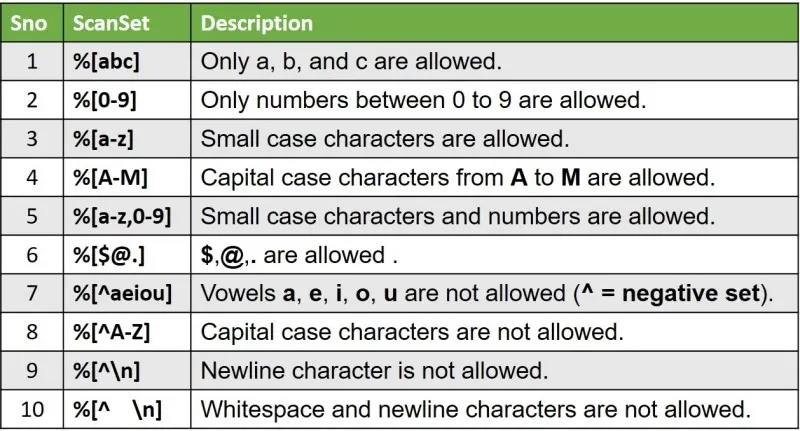

# Strings in C

## Definisi
Strings merupakan kumpulan karakter (array of characters) yang digabungkan menjadi satu yang ditambahkan null character (`\0`) sebagai penanda akhir dari string.

Sintaks:

```c
char variableName[size];
```

karena strings sendiri merupakan array, kita bisa mengakses setiap karakter menggunakan metode array pada umumnya.

Misal:

```c
char nama[5] = "Andi";
printf("%c", nama[3]);
```

Output dari kode tersebut adalah `i`.

## Deklarasi dan inisialisasi

Terdapat beberapa cara deklarasi dan inisialisasi pada string.

Cara 1 (deklarasi saja):
```c
char var[50];
```

Cara 2 (deklarasi dan inisialisasi):

```c
char var[50] = "Ini adalah sebuah string.";
```

Cara 3:

```c
char var[] = "Ini adalah sebuah string tanpa definisi ukuran.";
```

String dapat diinisialisasikan tanpa didefinisikan ukuran dari variabel tersebut, namun cara ini hanya berlaku bila variabel langsung diinisialisasi.

## string.h

string.h merupakan library dalam C yang memiliki fungsi-fungsi yang dapat digunakan untuk operasi string.

Beberapa contoh fungsi pada string.h:

```c
#include <stdio.h>
#include <string.h>
int main(){

char nama1[50] = "Hello World";
char nama2[50] = "hello world";

// strcmp(var1,var2)
// Komparasi string berdasarkan nilai ASCII
// nilai > 0 = variabel pertama lebih besar
// nilai < 0 = variabel kedua lebih besar
// 0 = string sama persis
printf("%d\n", strcmp(nama1, nama2));

// strlen(var)
// Mengembalikan jumlah karakter pada string. tidak termasuk null character
printf("%zu\n", strlen(nama1));


// strcat(dest, source)
// Menambahkan salinan dari source ke destination
strcat(nama1, nama2);
printf("%s\n", nama1);

// strcpy(dest, source)
// Overwrite string dest dengan string dari source
strcpy(nama1, nama2);
printf("%s\n", nama1);

return 0;
}

```

Pada strcat dan strcpy, pastikan ukuran cukup agar tidak menimpa memori yang lain.

## String Input

Terdapat beberapa cara untuk menginputkan string dari pengguna.

### scanf()

scanf() merupakan cara paling simpel untuk menginputkan string.

```c
char var[10];
scanf("%s", var);
printf("%s\n", var);
```

:::warning
Kekurangan dari metode ini adalah bila terdapat spasi, program tidak akan membaca string setelah spasi tersebut.

Selain itu, besar kemungkinan untuk terjadinya buffer overflow, yaitu keadaan saat ukuran input lebih besar dibandingkan dengan ukuran variabel atau tempat penyimpanan input tersebut.
:::

### fgets()

Metode ini lebih aman digunakan untuk digunakan dibandingkan dengan scanf karena mampu membatasi jumlah karakter yang dibaca.

fgets akan membaca baris secara utuh hingga terdapat newline (`\n` atau tombol enter), EOF (End Of File), atau telah mencapai batas maksimum ukuran.

```c
char buff[100];

printf("Enter a string:\n");

fgets(buff, sizeof(buff), stdin);

printf("You entered: %s", buff);
```

Sintaks: 

```c
fgets(buff, n, stream);
```

Keterangan parameter:

`buff`: Pointer ke string buffer atau variabel sebagai tempat input akan disimpan
`n`: Jumlah karakter maksimum yang akan dibaca (termasuk `\0`)
`stream`: Input stream, umumnya `stdin` untuk membaca input dari keyboard

Output dari fungsi ini adalah pointer yang merujuk ke `buff` bila berhasil dan `NULL` bila gagal atau telah mencapai EOF.

:::warning
Kekurangan dari metode ini adalah newline dari input akan dibaca yang biasanya digunakan sebagai penanda akhir dari pembacaan input bila masih terdapat ruang, sehingga biasanya harus dibuang terlebih dahulu agar program berjalan dengan sesuai.

Bila tidak ada ruang yang tersisa, maka input akan tersisa di buffer.
:::
### scanf() dengan Scanset

Metode ini merupakan metode scanf() dengan tambahan penggunaan scanset, yaitu format specifier spesial yang dapat menerima atau menolak input sesuai dengan scanset yang diberikan.



Contoh:

```c
char str1[10];
char str2[10];
scanf("%9[^\n]", str1);
scanf("%9[^\n]", str2);

printf("%s, %s", str1, str2);

```

Pada contoh di atas, program akan menerima maksimal 9 karakter dan tidak akan menerima input newline ke str1 dan str2.

:::info
Pada contoh di scanf menggunakan scanset, newline akan tetap terbaca di scanf() pada str2 karena newline masih tertinggal di buffer, sehingga program akan langsung menolak input pada scanf() pada str2.

Terdapat beberapa metode untuk mengatasi masalah tersebut dengan salah satu caranya dengan menambahkan spasi di scanf.

Menggunakan contoh di atas:

```c
char str1[10];
char str2[10];
scanf("%9[^\n]", str1);
scanf(" %9[^\n]", str2);

printf("%s, %s", str1, str2);
```

Program akan mengabaikan newline yang masih tersisa pada buffer, sehingga program tidak melewati scanf kedua.
:::

## Pointers in Strings

Pada contoh di bawah:

```c
char str[] = "Hello World";
```

nama variabel dari array, `str`, merujuk ke karakter pertama pada string tersebut.

:::info
Secara teknis, nama dari array bukanlah pointer, namun akan decay menjadi pointer yang merujuk ke elemen pertama dari array tersebut.
:::

```c
char str[] = "Hello World";
printf("%c", *str);
```

Program akan mencetak huruf `H`.

Karena nama variabel dari array menunjuk ke elemen pertama, maka dapat dibuat pointer untuk iterasi setiap karakter pada sebuah string.

Contoh:

```c
char str[] = "Hello World";
char* ptr = str;

while(*ptr != '\0'){
	printf("%c", *ptr++);
}
printf("\n%s", str);
```

Pada kode di atas, dapat dilihat bahwa kedua metode menghasilkan output yang sama.

## String Literal

String literal merupakan string yang dibungkus dengan kutip ganda (""). String literal secara otomatis akan memilki `\0` di akhir dan biasanya disimpan di memori read-only, sehingga percobaan untuk merubah string literal akan berdampak pada undefined behavior.

Contoh:

```c
const char *str = "Hello World";
printf("%s\n", str);
```

Pointer akan menunjuk pada string literal yang diberikan. Data string bersifat constant atau read-only, sehingga tidak dapat dilakukan modifikasi pada string tersebut.

### Perbedaan inisialisasi pada pointer dengan array

```c
char *ptr = "Hello 1";
char arr[] = "Hello 2";
```

Pada contoh di atas, ptr menunjuk pada read-only literal di memori, sehingga `Hello 1`tidak dapat diubah (Bila dipaksa, maka akan terjadi undefined behavior / segmentation fault). Pada arr, string `Hello 2` akan disalin ke arr sehingga nilai arr yang berisikan string tersebut dapat diubah. Ini karena inisialisasi arr sama saja seperti:

```c
char arr[] = {'H', 'e', 'l', 'l', 'o', ' ', '2', '\0'};
```

:::info
Ingat bahwa string yang menggunakan kutip ganda akan selalu diikuti `\0` sebagai penanda akhir string tersebut.
:::