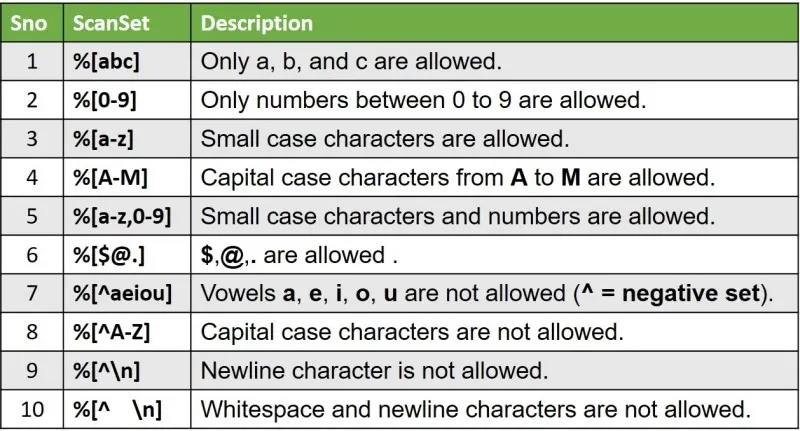

# Strings in C

## Definisi

String di C adalah array karakter (`char`) yang diakhiri dengan _null character_ (`\0`) sebagai penanda akhir string.

Sintaks:

```c
char variableName[size];
```

Karena string adalah array, setiap karakternya dapat diakses dengan indeks seperti array pada umumnya.

Contoh:

```c
char nama[5] = "Andi";
printf("%c", nama[3]);
```

Output:

```
i
```

:::info
Ukuran array harus **minimal jumlah karakter + 1**, karena satu elemen dipakai untuk `\0`. Pada contoh di atas, "Andi" terdiri dari 4 karakter, sehingga membutuhkan array berukuran 5.

| Indeks | 0   | 1   | 2   | 3   | 4    |
| ------ | --- | --- | --- | --- | ---- |
| Isi    | `A` | `n` | `d` | `i` | `\0` |

:::

## Deklarasi dan Inisialisasi

Terdapat beberapa cara deklarasi dan inisialisasi string.

Cara 1 (deklarasi saja):

```c
char var[50];
```

Cara 2 (deklarasi dan inisialisasi):

```c
char var[50] = "Ini adalah sebuah string.";
```

Cara 3 (tanpa menentukan ukuran):

```c
char var[] = "Ini adalah sebuah string tanpa definisi ukuran.";
```

Ukuran array boleh tidak ditulis, namun cara ini hanya berlaku bila variabel langsung diinisialisasi. Compiler akan menghitung ukurannya secara otomatis (termasuk `\0`).

## Menampilkan String

String dapat ditampilkan dengan `printf` menggunakan format specifier `%s`, atau dengan `puts()`.

```c
char var[] = "Halo";

printf("%s\n", var);  // mencetak string, newline harus ditulis sendiri
puts(var);            // mencetak string, otomatis menambahkan newline
```

Output:

```
Halo
Halo
```

## string.h

`string.h` adalah library dalam C yang berisi fungsi-fungsi untuk operasi string.

Contoh beberapa fungsinya:

```c
#include <stdio.h>
#include <string.h>

int main() {
    char nama1[50] = "Hello World";
    char nama2[50] = "hello world";

    // strcmp(var1, var2)
    // Membandingkan dua string berdasarkan nilai ASCII karakter
    // nilai > 0 = string pertama lebih besar
    // nilai < 0 = string kedua lebih besar
    // 0         = kedua string sama persis
    // Catatan: nilai pastinya bisa berbeda antar compiler,
    // jadi bandingkan dengan > 0, < 0, atau == 0, bukan angka tertentu.
    printf("%d\n", strcmp(nama1, nama2));

    // strlen(var)
    // Mengembalikan jumlah karakter pada string, tidak termasuk '\0'
    printf("%zu\n", strlen(nama1));

    // strcat(dest, source)
    // Menambahkan salinan source di akhir dest
    // Pastikan: strlen(dest) + strlen(source) + 1 <= ukuran dest
    // Di sini: 11 + 11 + 1 = 23 <= 50, aman
    strcat(nama1, nama2);
    printf("%s\n", nama1);

    // strcpy(dest, source)
    // Menimpa isi dest dengan isi source
    // Pastikan ukuran dest cukup untuk menampung source + '\0'
    strcpy(nama1, nama2);
    printf("%s\n", nama1);

    return 0;
}
```

Output (nilai `strcmp` dapat berbeda tergantung compiler, tetapi tandanya negatif):

```
-32
11
Hello Worldhello world
hello world
```

Nilai `strcmp` negatif karena huruf `H` (ASCII 72) lebih kecil daripada `h` (ASCII 104).

:::warning
`strcat` dan `strcpy` **tidak memeriksa ukuran** tujuan. Jika ukuran tidak cukup, data akan menimpa memori lain (_buffer overflow_).
:::

### Alternatif yang Lebih Aman

Gunakan `snprintf` untuk menyalin atau menggabungkan string dengan batas ukuran yang jelas:

```c
char hasil[20];

snprintf(hasil, sizeof(hasil), "%s", "Hello World");  // salin dengan batas
printf("%s\n", hasil);

snprintf(hasil + strlen(hasil), sizeof(hasil) - strlen(hasil), "!!!");  // gabung dengan batas
printf("%s\n", hasil);
```

Output:

```
Hello World
Hello World!!!
```

`snprintf` selalu menulis maksimal `sizeof(hasil)` karakter (termasuk `\0`) sehingga tidak akan melampaui ukuran array.

:::info
Ada juga `strncpy` dan `strncat`, tetapi keduanya punya jebakan: `strncpy` **tidak menjamin** adanya `\0` di akhir jika string sumber lebih panjang dari batas. Karena itu `snprintf` biasanya lebih mudah dipakai dengan benar.
:::

## String Input

Terdapat beberapa cara untuk menerima input string dari pengguna.

### scanf()

`scanf()` adalah cara paling sederhana.

```c
char var[10];
scanf("%9s", var);
printf("%s\n", var);
```

Angka `9` membatasi jumlah karakter yang dibaca agar tidak melebihi ukuran array (`10 - 1`, sisanya untuk `\0`).

:::warning
Kekurangan metode ini:

- `%s` berhenti membaca saat bertemu spasi, sehingga input seperti "Hello World" hanya terbaca "Hello".
- Tanpa batas lebar (misalnya hanya `%s`), input yang lebih panjang dari array akan menyebabkan _buffer overflow_, yaitu kondisi saat data yang ditulis melebihi ukuran tempat penyimpanannya.
  :::

### fgets()

`fgets()` lebih aman daripada `scanf("%s")` karena membatasi jumlah karakter yang dibaca.

`fgets` membaca satu baris hingga salah satu kondisi ini terpenuhi: ditemukan newline (`\n`, dari tombol Enter), mencapai EOF (End Of File), atau telah membaca `n - 1` karakter.

```c
char buff[100];

printf("Enter a string:\n");

fgets(buff, sizeof(buff), stdin);

printf("You entered: %s", buff);
```

Sintaks:

```c
fgets(buff, n, stream);
```

Keterangan parameter:

- `buff`: pointer ke buffer (variabel) tempat input disimpan.
- `n`: jumlah karakter maksimum yang dibaca, **termasuk** `\0`.
- `stream`: sumber input. Umumnya `stdin` untuk membaca dari keyboard.

Nilai kembalian: pointer ke `buff` bila berhasil, atau `NULL` bila gagal atau langsung mencapai EOF.

:::warning
Kekurangan metode ini:

- Karakter newline (`\n`) **ikut disimpan** di dalam buffer jika masih ada ruang. Akibatnya, `printf("%s")` akan mencetak baris baru tambahan, dan perbandingan string bisa salah.
- Jika input lebih panjang dari ruang yang tersedia, sisanya tetap berada di buffer `stdin` dan akan terbaca pada pemanggilan input berikutnya.
  :::

Cara menghapus newline dari buffer:

```c
#include <string.h>

fgets(buff, sizeof(buff), stdin);
buff[strcspn(buff, "\n")] = '\0';
```

`strcspn(buff, "\n")` mengembalikan posisi `\n` pertama (atau panjang string jika tidak ada), lalu posisi tersebut diganti dengan `\0`.

### scanf() dengan Scanset

Metode ini menggunakan _scanset_, yaitu format specifier khusus berbentuk `%[...]` yang menentukan karakter mana saja yang boleh dibaca.

| Scanset   | Arti                                                       |
| --------- | ---------------------------------------------------------- |
| `%[abc]`  | Baca selama karakter berupa `a`, `b`, atau `c`             |
| `%[a-z]`  | Baca selama karakter berupa huruf kecil `a` sampai `z`     |
| `%[^abc]` | Baca selama karakter **bukan** `a`, `b`, atau `c`          |
| `%[^\n]`  | Baca semua karakter sampai ketemu newline (termasuk spasi) |


Contoh:

```c
char str1[10] = "";
char str2[10] = "";

scanf("%9[^\n]", str1);
scanf("%9[^\n]", str2);

printf("%s, %s", str1, str2);
```

Pada contoh di atas, setiap `scanf` membaca maksimal 9 karakter dan berhenti sebelum newline.

:::info
Masalah pada contoh di atas: setelah `scanf` pertama selesai, karakter newline dari tombol Enter **tertinggal di buffer**. Pada `scanf` kedua, `%[^\n]` langsung berhenti karena karakter pertama yang dilihatnya adalah `\n`, sehingga tidak ada yang dibaca dan `str2` tetap kosong. Karena itu `str2` sebaiknya diinisialisasi (`= ""`), jika tidak isinya tidak terdefinisi.

Salah satu solusinya adalah menambahkan spasi sebelum `%` pada format. Spasi akan membuat `scanf` melewati semua whitespace (termasuk newline) yang tersisa sebelum mulai membaca.
:::

```c
char str1[10] = "";
char str2[10] = "";

scanf("%9[^\n]", str1);
scanf(" %9[^\n]", str2);

printf("%s, %s", str1, str2);
```

## Pointers in Strings

Perhatikan contoh berikut:

```c
char str[] = "Hello World";
```

Nama array, `str`, merujuk ke karakter pertama pada string tersebut.

:::info
Secara teknis, nama array bukanlah pointer, tetapi pada kebanyakan ekspresi ia akan _decay_ (berubah) menjadi pointer ke elemen pertama array.
:::

```c
char str[] = "Hello World";
printf("%c", *str);
```

Program akan mencetak `H`.

Karena nama array menunjuk ke elemen pertama, kita dapat membuat pointer untuk menelusuri setiap karakter pada string:

```c
char str[] = "Hello World";
char *ptr = str;

while (*ptr != '\0') {
    printf("%c", *ptr);
    ptr++;
}
printf("\n%s", str);
```

Output:

```
Hello World
Hello World
```

Kedua cara menghasilkan output yang sama.

:::info
Kamu mungkin juga melihat bentuk singkat `printf("%c", *ptr++);`. Artinya: ambil nilai yang ditunjuk `ptr` terlebih dahulu, lalu geser `ptr` ke karakter berikutnya. Bentuk ini ringkas, tetapi versi dua baris di atas lebih mudah dibaca untuk pemula.
:::

## String Literal

String literal adalah string yang dibungkus tanda kutip ganda (`""`). Secara otomatis string literal memiliki `\0` di akhir, dan biasanya disimpan di memori _read-only_. Mencoba mengubahnya menyebabkan _undefined behavior_.

Contoh:

```c
const char *str = "Hello World";
printf("%s\n", str);
```

Pointer `str` menunjuk ke string literal yang bersifat konstan, sehingga isinya tidak boleh dimodifikasi. Penulisan `const` membuat compiler memberi peringatan bila ada kode yang mencoba mengubahnya.

### Perbedaan Inisialisasi Pointer dengan Array

```c
const char *ptr = "Hello 1";
char arr[] = "Hello 2";
```

- `ptr` menunjuk ke literal `Hello 1` yang berada di memori read-only, sehingga isinya tidak dapat diubah. Jika dipaksa, akan terjadi undefined behavior (sering berupa _segmentation fault_).
- `arr` berisi **salinan** dari `Hello 2`, sehingga isinya dapat diubah. Inisialisasi ini setara dengan:

```c
char arr[] = {'H', 'e', 'l', 'l', 'o', ' ', '2', '\0'};
```

Perbandingannya:

```c
arr[0] = 'J';   // OK, arr menjadi "Jello 2"
ptr[0] = 'J';   // undefined behavior (dengan const, compiler menolak kode ini)
```

:::info
Ingat bahwa string dengan kutip ganda selalu diikuti `\0` sebagai penanda akhir string.
:::

## Kesalahan Umum

**1. Menyalin string dengan `=`**

```c
char a[20] = "Halo";
char b[20];
b = a;            // ERROR: array tidak bisa di-assign
strcpy(b, a);     // BENAR
```

**2. Membandingkan string dengan `==`**

```c
char a[] = "Halo";
char b[] = "Halo";

if (a == b) { }               // SALAH: membandingkan alamat memori, bukan isi
if (strcmp(a, b) == 0) { }    // BENAR
```

**3. Lupa menyisakan ruang untuk `\0`**

```c
char s[4] = "Halo";   // SALAH: butuh 5 elemen (4 huruf + '\0')
char s[5] = "Halo";   // BENAR
```

**4. Menggunakan `scanf("%s")` tanpa batas lebar**

```c
char s[10];
scanf("%s", s);     // berisiko overflow
scanf("%9s", s);    // lebih aman
```

## Ringkasan

- String di C adalah array `char` yang diakhiri `\0`; ukuran array = jumlah karakter + 1.
- Gunakan `strcmp`, `strcpy`, `strcat`, dan `strlen` dari `string.h`, dengan memastikan ukuran tujuan cukup.
- `snprintf` adalah alternatif yang lebih aman untuk menyalin dan menggabungkan string.
- Untuk input, `fgets` lebih aman daripada `scanf("%s")`, tetapi newline-nya harus dibuang.
- Scanset (`%[^\n]`) memungkinkan membaca satu baris termasuk spasi; newline yang tertinggal di buffer perlu ditangani.
- Nama array akan decay menjadi pointer ke elemen pertama.
- String literal bersifat read-only: gunakan `const char *` untuk pointer, atau `char[]` jika isinya perlu diubah.

## Latihan

1. Buat program yang membaca satu baris (boleh mengandung spasi) dengan `fgets`, lalu mencetak panjangnya tanpa menghitung newline.
2. Buat program yang menghitung jumlah huruf vokal pada sebuah string.
3. Buat program yang membalik sebuah string (contoh: `"Halo"` menjadi `"olaH"`) tanpa menggunakan library selain `stdio.h`.
4. Buat program yang memeriksa apakah sebuah string adalah palindrom (contoh: `"katak"`).
5. Jelaskan mengapa kode berikut menyebabkan masalah, lalu perbaiki:

    ```c
    char *s = "Hello";
    s[0] = 'J';
    ```
